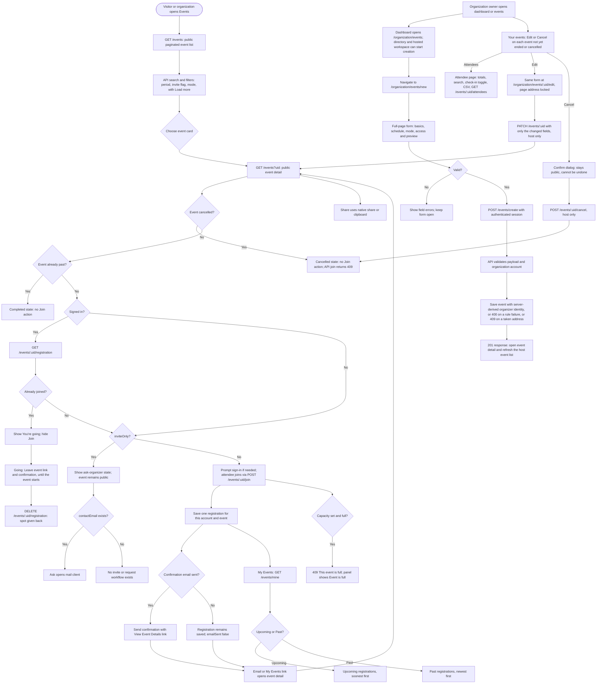

# Events

Covers the events directory, the shared event form (publish and edit, with its
optional details), cancelling an event, leaving an event, capacity, the organizer's
attendee list and check-in, and the event display components. The retired legacy form
(`CreateEvent.tsx`) was deleted in November 2026.

## Event lifecycle: agent reference

This section records the current end-to-end behavior, including the gaps that
matter when changing the module. The Events page is public: visitors fetch
`GET /events` a page of 12 at a time, with search, the Upcoming/Past split and
the type filter applied by the API, then open `/events/:eventId` from an event
card. Event detail fetches
`GET /events?uid={uid}` and renders the event, organizer, mode-specific location
or online information, and any optional detail fields present on the record.
Past events show a completed state, with no join action. A **cancelled** event
(November 2026, PG-2) stays in the directory, on the detail page and in My Events
with a "Cancelled" label instead; its Join action is replaced by a short
explanation, and the API refuses a join with `409`. Cancelled wins over
completed: a cancelled event that has since passed is still cancelled. Upcoming
events marked
`inviteOnly` remain visible in the public directory and detail page; the detail
page replaces Join with “ask the organizer.” There is no invitation list, invite
delivery, access check, or approval flow, so `inviteOnly` is currently a display
flag rather than private access control. For an upcoming event that is not
invite-only, Join requires a signed-in account and saves one registration per
account. Production sends the attendee a confirmation email; local development
suppresses delivery. Event detail checks the signed-in account's registration on
load and shows “You are going” in place of Join when already registered. An
event can have a **capacity** (November 2026, PG-5): the API reserves a spot on
join, refuses a join with `409 "This event is full."`, and returns `capacity` and
`registrationCount`; the web shows going and spots left (on the card, the facts
strip, the join panel and the mobile bar) **only for an event with a capacity**,
and "No limit" otherwise, because only a capped event has a trustworthy count.
A full event shows "Event is full" to everyone who does not already hold a place.
Someone who is going can **leave** (PG-3): a "Leave event" link under the status
line opens a confirmation, calls `DELETE /events/:uid/registration`, gives the
spot back, and the page refreshes the event and the registration state. Leaving
is only offered until the event starts (the API refuses it after).

Three more fields shape what people see (November 2026). An event's **format**
is In person, Online or **Hybrid** (PG-10): a Hybrid event has a venue and a live
stream, shows "Hybrid · City, Country" on cards and lists, and answers both "where"
and "how to join" on its page, venue first. Every event can have a **kind**
(Volunteering drive, Fundraiser, Workshop or training, Awareness campaign, Meetup or
networking, Cultural or community event, Other) and up to eight **tags** (PG-9):
the kind is a label on the card and a badge on the page, the tags are `#chips` on
the page and are matched by the directory search. An event can also be a **draft**
(PG-15): saved, but only its own organization can see it. A draft is not in the
directory, the organization's public profile or its dashboard, cannot be opened by
address by anyone else (it answers as not found), and cannot be joined; the owner
sees it in Your events marked "Draft" and can open it with a banner saying so. Share uses the browser share
sheet or clipboard, and Ask opens a mail link only when the event has a contact
email. Organizations can find their hosted events at `/organization/events` and
on their public organization profile, both backed by
`GET /events?host={handle}`. Individual attendees can find saved registrations
at `/events/mine`, linked from the signed-in Profile menu and backed by
authenticated `GET /events/mine?period=upcoming|past`. The host event list at
`/organization/events` contains event records only. The organization dashboard
shows total registrations and per-event registration counts, but not attendee
names or attendance check-in; those live on the separate attendee page above.
The organization sees **who is coming** at
`/organization/events/:eventId/attendees` (November 2026, PG-6): totals (registered
of capacity, checked in), a search on name or email, a check-in toggle per person,
a "Download CSV" button and a "Load more attendees" button (50 at a time). Only the
hosting organization can open it, and a new registration also emails the
organization owner in production. Organizations manage a hosted event from
`/organization/events`: **Attendees** opens that list, **Edit** opens
the shared form at `/organization/events/:eventId/edit`, and **Cancel event**
opens a confirmation dialog and calls `POST /events/:uid/cancel`. Neither
notifies the people who joined (PG-18).

### Publishing path and implementation boundary

The backend supports publishing through authenticated `POST /events/create`,
validates the event, verifies the account is an organization, stores the record
with the authenticated organization's identity, and returns `201`. Organization
owners can create events from the public `/events` directory or the hosted-event
workspace at `/organization/events`. Both actions navigate to the full-page form
at `/organization/events/new`; no event-creation modal remains in the live flow.
The dashboard's create/manage action opens the hosted-event workspace, where the
create action opens that same page. The public directory shows its creation
action from Redux's authenticated organization state, without trying to read the
HTTP-only `Token` cookie in browser JavaScript. The shared page submits to
authenticated `POST /events/create` through `useEvent.ts`, then opens the
published event detail page. The current organization's hosted-event list cache
is revalidated after success, and the public directory refetches when `/events`
is next opened. The form covers event
basics, date/time, online or in-person details, invite-only visibility, an
optional maximum number of attendees, a section of optional details (below), and
a live preview. The old `CreateEvent.tsx` component (which called
`PATCH /user/update` instead of creating an event) was deleted in November 2026.

**Editing and cancelling (November 2026, PG-1 and PG-2).** Each event in
`/organization/events` that has not ended and is not cancelled has an Edit link
and a Cancel button. Edit opens `EditEvent.tsx` at
`/organization/events/:eventId/edit` (behind `RequireSignIn`), which loads the
event with `GET /events?uid=`, checks in the browser that the signed-in
organization hosts it, and renders the same `EventForm` the create page uses,
filled in. The page address is read-only, because registrations point at it and
links people already hold must keep working. Saving sends only what changed to
`PATCH /events/:uid` (`buildEventChanges`), so the cover image is not re-sent
unless a new one was picked and a start time left alone is never re-sent. A
cancelled event or one that has ended shows an explanation instead of the form.
On success the page revalidates that event and the host list, shows "Event
updated" and opens the event page. Cancel opens `CancelEventDialog` (a native
`<dialog>`, with "Keep event" focused first because cancelling cannot be undone),
then calls `POST /events/:uid/cancel` and revalidates the host list. A cancelled
event stays public with a badge; there is no reinstate and no delete.
The events feature has no `services/` folder: every event API call is in
`src/services/KarmaCircleApi.ts` (writes) or goes through `useSWR` with
`eventEndpoints` (reads). The create endpoint currently accepts the basic event fields and
`inviteOnly`; most long-form detail fields shown by the detail page are not
accepted by its request schema yet. Read the frontend deep spec at
[events/SPEC.md](../../apps/web/src/features/events/SPEC.md), the backend spec
at [apps/api/docs/specs/events.md](../../apps/api/docs/specs/events.md), and the
route cross-reference at
[apps/api/docs/specs/api-contract.md](../../apps/api/docs/specs/api-contract.md)
before changing this path.

The organizer roster and check-in (PG-6) are now built: the Attendees page in the
diagram below. The organization dashboard still shows only aggregate registration
totals and per-event counts, and the hosted-event list at `/organization/events`
includes event records and the Attendees, Edit and Cancel actions. The attendee experience is end to end: successful
join persists the registration independently of email delivery, and opening a
confirmation or My Events link loads registration state so an existing attendee
sees “You're going” instead of Join.

## `Events.tsx` — routed at `/events`

[apps/web/src/features/events/pages/Events.tsx](../../apps/web/src/features/events/pages/Events.tsx).
Renders `<ComponentHelmet type="Events" />` (fixed August 2026 — previously
passed `"Organizations"`, a copy-paste leftover that showed the Organizations
SEO copy instead of the `"Events"` branch `ComponentHelmet` already had; see
[layout-navigation.md](./layout-navigation.md)), `<Navbar />`, a page heading,
the shared `DirectoryToolbar` (search, an Upcoming/Past `FilterDropdown` plus a
second invite/mode `FilterDropdown` via its `secondaryFilter` prop, live result
count, primary button), one flat grid of `<EventCard />` with an empty state,
and `<Footer />`.

**Live data, September 2026.** `GET /events` (`eventEndpoints.directory({ period, search, mode, inviteOnly,
page, limit })`, 12 per page) via `useSWRInfinite`, with `keepPreviousData` and
`revalidateAll`, mapped through
[utils/toDisplayEvent.ts](../../apps/web/src/features/events/utils/toDisplayEvent.ts)
into the looser `EventCardEvent` shape `EventCard` actually needs. Replaces the
twelve-event fixture that used to live in `constants/eventDirectory.ts` — that
file, its `constants/eventDetails.ts` companion, and their placeholder cover
photos are deleted outright, not just unused, now that `DetailedEvent.tsx` is
live too (see that page's section below).

Two real, deliberate differences from `/organizations`' directory, both because
an event has a date and an organization doesn't:

- **The primary filter dropdown's taxonomy is Upcoming/Past, not a cause
  taxonomy.** A live `Event` has no cause field at all
  ([event.model.ts](../../apps/api/src/modules/events/event.model.ts)) —
  inventing one the way the old fixture did would be exactly the kind of
  fabricated-but-unlabelled data this rewrite exists to remove. "What's
  happening soon" is also just the more useful question for an events page to
  answer than a cause split ever was.
- **A second filter dropdown** (`TypeFilter` -
  `"All" | "Invite only" | "Open to all" | "Online" | "Offline"`,
  September 2026) narrows by two real `Event` fields, `inviteOnly` and `mode`.
  It's one flat single-select list, not two independently-combinable dropdowns
  or a multi-select - picking one clears the others, so "online" and "invite
  only" can't be filtered together today; see `Events.tsx`'s own `TypeFilter`
  comment for why that tradeoff was made over a heavier multi-select
  `FilterDropdown` variant that doesn't exist yet. Wired into `DirectoryToolbar`
  via a new optional `secondaryFilter` prop, since the component previously
  supported exactly one filter dimension (see
  [08-components-shared.md](./design-system/08-components-shared.md#directorytoolbar)).

**Results render as one flat grid (September 2026), not grouped by day.** Until
September 2026 results were bucketed into same-day sections
(`utils/groupEventsByDay.ts`, now deleted) - "Today"/"Tomorrow"/"Yesterday",
else a full weekday+date. With the seed data's actual date spread, most
day-sections held exactly one event, so the headers added visual structure
without adding real information; `EventCard`'s own cover-photo date badge
already tells a visitor which day an event falls on. Sort direction still flips
with the time filter: soonest-first for Upcoming, most-recent-first for Past,
now decided by the API (start time, with the event id as tiebreaker).

**Kind filter (November 2026, PG-9).** The toolbar has a third dropdown,
"Filter by kind" ("All kinds" plus the seven kinds), next to the Upcoming/Past and
the access/format ones (`DirectoryToolbar` gained an optional `tertiaryFilter`
beside `secondaryFilter`). It is its own dropdown because kind and format or access
can be asked together. The format/access dropdown now also has a **Hybrid** option.
Choosing a kind sends `type=<slug>` (`eventEndpoints.directory({ type })`); an
event with no kind never matches it.

**Search, filters and paging are server-side (November 2026).** `GET /events`
(`listEventsQuerySchema`, apps/api) takes `search`, `period`, `mode` and
`inviteOnly` as well as `uid`/`slug`/`host`/pagination. The search box is
debounced by 300 ms and matched by the API against the name, city and host name
(the old browser search also matched summary, country, platform and mode). The
type filter maps `Invite only` to `inviteOnly=true`, `Open to all` to
`inviteOnly=false`, and `Online`/`Offline` to `mode`. The count above the grid is
`pagination.total`, and a "Load more events" pill button (same style as "Reset
filters") fetches the next page; the page has error and retry states. A newly
created event appears when `/events` is reopened because the page passes
`revalidateAll: true` (SWR's global `mutate` skips `useSWRInfinite` keys, so
`useEvent.ts` does not refresh the directory itself). Search is an unindexed
case-insensitive scan on the API side, fine at today's scale.

**`EventCard` now handles a live record's real gaps rather than a fixture that
had none:** no cover photo → an accent-gradient block with a calendar mark (same
derivation as `OrganizationCard`'s no-cover fallback); no `organizerHandle` (an
individual host, per `event.model.ts`) → the organizer name renders as plain
text instead of a link; no capacity data → the "N going / spots left" rule at
the bottom is omitted entirely rather than showing invented numbers (see
[known-issues.md](./known-issues.md#events--rsvp-and-attendee-capacity-future-scope-deliberately-not-built)
— real capacity tracking is future scope, not built).

**September 2026:** two badge pills — "Govt" (`event.isGovernmentSponsored`) and
"Invite only" (`event.inviteOnly`) — render top-right on the cover, in the slot
`OrganizationCard`'s "Featured" pill uses, when the underlying `Event` document
carries either flag. The meta row's vertical spacing was also loosened and its
date/time line's icon changed from a repeated `FiCalendar` to `FiClock`, so the
date badge and the time line read as two distinct facts rather than the same one
twice.

Event creation is available to signed-in organization accounts from the public
directory and hosted-event workspace. The directory checks Redux login state and
`userType === "organization"`; it does not read the HTTP-only `Token` cookie
from browser JavaScript. Personal accounts and signed-out visitors see no
creation link; browsing, search, and filters remain public. The API
independently rejects personal-account creation requests with `403`, using the
stored account type. `e2e/events/events-responsive.spec.ts` covers the public
directory's Upcoming/Past filtering, search, type filter and responsive layout,
plus an organization publishing an in-person event from the full-page form.
`e2e/events/attendee-journey.spec.ts` (detail page, joining, "You are going", My
Events, invite-only, past event), `e2e/events/online-event-publishing.spec.ts`
(online platform and meeting link) and `e2e/events/event-management.spec.ts`
(edit and cancel, below), `e2e/events/event-attendees.spec.ts` (leave,
capacity, attendee list) and `e2e/events/event-details.spec.ts` (optional details),
`e2e/events/event-hybrid.spec.ts`, `e2e/events/event-kind.spec.ts` and
`e2e/events/event-drafts.spec.ts` were added in November 2026, and
`events-responsive.spec.ts` was changed to create future events that end after they
start and to move its past event with the E2E-only backdate route. Results on
2026-11-16: the first 15 specs passed on Chromium, Firefox and WebKit (45 of 45);
the 26 after attendees and details pass on each browser run alone, and one run of
all three at once passed 76 of 78 (a WebKit failure in the full-event test and a
Firefox failure in the default-platform test, both timeouts under heavy load that
pass alone, see T-10 in the events to-do list); and all 37 tests of the whole folder,
including Hybrid, kind and drafts, passed on Chromium; with
`e2e/events/event-contribute.spec.ts`, `e2e/events/event-timezone.spec.ts` and the
formatted write-up test in `event-details.spec.ts` added, all 45 passed on Chromium. Every publishing test now
picks the form's required "Kind of event" first (`chooseKind` in
`event-helpers.ts`). Pure
helpers have Vitest unit tests (see [testing.md](./testing.md)).

`event-management.spec.ts` (4 tests): an organization edits an event from Your
events (the page address is locked, the form starts as stored, the change shows
on the event page and in the API); saving an unchanged form sends nothing;
cancelling (the dialog can be dismissed with no change, then confirmed; the row
shows "Cancelled" with no actions; the public page says the event was cancelled
and offers no Join; the API refuses a join with `409`; the edit page explains
instead of showing a form); and another organization is refused both in the page
and by the API (`403`).

**"Cancelled" (November 2026, PG-2).** `EventCard` shows a grayscale cover and a
"Cancelled" label in the same bottom-left slot "Completed" uses, and wins over it.
`toDisplayEvent.ts` maps `status === "cancelled"` onto `EventCardEvent.cancelled`.

**Width fixed to `max-w-6xl` (September 2026).** Both content wrappers here were
`max-w-7xl`, wider than `Navbar` and every other page's container — the
identical drift `/organizations` had, from the same original pass. Full
explanation: [organizations.md](./organizations.md),
[layout-navigation.md](./layout-navigation.md#navbar).

## `YourEvents.tsx` — the organization's own events

[apps/web/src/features/events/pages/YourEvents.tsx](../../apps/web/src/features/events/pages/YourEvents.tsx),
routed at `/organization/events` (August 2026). This is where the navbar's "Your
events" points and where organization owners find and manage hosted events. Its
"Create event" action links to `/organization/events/new`.

Two things make it different from the `/events` directory above it:

- **It is behind `OrganizationSetupGate`**
  ([organizations.md](./organizations.md#the-setup-flow--organizationsetup)) — a
  draft organization is told what is still missing and handed a link that
  resumes setup, rather than shown an events page it cannot yet use.
- **It renders live records, not the fixture.** It fetches
  `GET /events?host={handle}`, a filter added to the API in the same change, so
  filtering happens server-side and nothing is hidden on page two.

It deliberately renders hosted events as owner-focused rows instead of reusing
the public directory card. Its "Create event" action opens the full-page
`CreateEvents.tsx` route at `/organization/events/new`.

**Attendees, edit and cancel (November 2026).** Every row has an **Attendees**
link (`/organization/events/:uid/attendees`), including ended and cancelled
events, so the list stays reachable. Below each row that has not ended and is
not cancelled also sit an **Edit** link (`/organization/events/:uid/edit`) and a
**Cancel event** button. The button opens `CancelEventDialog`; confirming calls
`CancelEvent(uid)` and revalidates the list, and a failure shows the API's
message in an error toast. A cancelled event stays in the list with a red
"Cancelled" pill and no actions; an event that has ended keeps only its link.
The row's main area is still one link to the public event page, with the
actions in a separate strip so they are never nested inside it.

**Drafts (November 2026, PG-15).** A draft row has a "Draft" label and **Edit**,
**Publish** and **Delete draft** actions, and no Attendees link. Publish calls
`POST /events/:uid/publish` (a draft whose start has since passed shows the API's
message in a toast) and the row loses its label. Delete draft opens a confirmation
("This can't be undone") and calls `DELETE /events/:uid`; a published event never
offers it. A published event that has not ended also gets **Unpublish** (a
confirmation, then `POST /events/:uid/unpublish`), which the API refuses with a
message saying to cancel instead once anyone has registered. One `pending` action
(cancel, unpublish or delete) drives whichever confirmation is open.

## `MyEvents.tsx` — an attendee's joined events

[apps/web/src/features/events/pages/MyEvents.tsx](../../apps/web/src/features/events/pages/MyEvents.tsx),
routed at `/events/mine` behind `RequireSignIn` and linked from the individual
account's Profile menu. It fetches the current account's registrations from
authenticated `GET /events/mine`, paginates in batches of 100, and sends the
selected period to the API so both tabs page and sort independently. Cards show
the event, organizer, date, location or online platform, and a "You're going"
status; each opens the event's live detail page. Loading, fetch failure, no
registrations, and empty time-period states are handled explicitly. The older
`UserProfile.tsx` has a static mock carousel but remains unrouted; it is not the
implementation used by this feature.

The empty state depends on the signed-in account's saved registrations. It does
not imply that event creation is the only way registrations can exist.

## Event creation components

One event form is connected to a live route. The legacy `CreateEvent.tsx`
(retired profile-editor copy that called `PATCH /user/update`) was deleted in
November 2026.

### `CreateEvents` (full-page organizer publishing flow)

[apps/web/src/features/events/components/CreateEvents.tsx](../../apps/web/src/features/events/components/CreateEvents.tsx).
A responsive page with a live preview, event name, date/time, mode, KarmaCircle
event-page address, description, cover upload, invite-only access, and
mode-specific location or meeting details. The event-page address is an internal
`/events/:uid` path, not an external website link; online meeting URLs require
HTTP or HTTPS. It is routed at `/organization/events/new` for signed-in
organization accounts with a live profile. Validation and submission go through
[useEvent](../../apps/web/src/features/events/hooks/useEvent.ts), which calls
the real `POST /events/create` API function (or, in edit mode, `PATCH /events/:uid`).

### Timezone and the formatted write-up (November 2026, PG-11 and PG-12)

**Timezone.** "When and where" has a **Timezone** select (every zone the browser
knows, labelled like "Asia/Kolkata (GMT+5:30)", defaulting to the browser's own).
The date and time pickers are read as the wall clock in that zone, not the browser's
(`combineInZone` in `utils/eventTimezone.ts`, built on dayjs's `utc` and `timezone`
plugins), so an organizer in London can set 10:00 in Tokyo and the stored start is
01:00 UTC. The preview names the zone. Editing reads the stored instants back as that
zone's wall clock (`partsInZone`), so whoever opens the form sees the times that were
typed, and changing only the zone moves the real moment (same digits, other clock).
An older event has no timezone and opens in the browser's zone; the zone is pinned
onto it only when something else is saved (opening the form and saving it unchanged
still says "Nothing has changed yet.").

On the pages, an event with a timezone shows its own clock with the zone named ("Wed
· May 1, 10:00 AM GMT+5:30") on the card (date badge and time), the hero, the join
panel's "Starts" line, My Events, Your events and the organization's events list
(`formatEventDate`, `formatEventBadge` and `formatEventTime` take an optional
timezone), and when the viewer's own clock is different at that moment the hero and
the panel add "(Tue · 9:30 PM your time)" (`viewerTimeNote`; nothing is added when
the offsets agree, so a reader in the event's own zone sees no note). Times that are
not an event's start, such as when someone registered, stay on the viewer's clock.
Agenda labels are free text the organizer writes in the event's own time. The join
confirmation email also uses the event's zone.

**Formatted write-up.** The "Full write-up" box supports a small, safe format
(`utils/richText.ts`, rendered by `components/RichText.tsx`): `**bold**`,
`*italic*` or `_italic_`, `[text](https://link)` (http and https only), lines
starting `- ` for bullets and `1. ` for a numbered list, and single line breaks;
paragraphs are separated by a blank line. It parses to plain data and renders React
elements, never HTML, so organizer text cannot inject markup: `<script>` and ``
stay literal text, a `javascript:` link stays literal text, links open in a new tab
with `rel="noopener noreferrer nofollow ugc"`, and a stray `*` or `snake_case_name`
is not mistaken for emphasis (emphasis must hug its text). Headings, images, tables,
code and nesting are deliberately not supported and show as typed. A live
**Preview** under the box shows how it will look. The limit is 4000 characters per
paragraph (up to 20 paragraphs), up from 2000. The short **description** (20 to 200
characters, the card summary) stays plain text: the full write-up is where the longer,
formatted text lives, which resolves PG-12.

### Format, kind, tags and drafts (November 2026, PG-9, PG-10 and PG-15)

**Format.** "Event format" has three buttons: In person, Online and **Hybrid** ("A
place and a live stream"). `utils/eventMode.ts` holds the two questions every
mode-dependent piece asks instead of "in person or online?": `hasVenue(mode)` (not
Online) and `hasOnlineAccess(mode)` (not In person). Hybrid shows both the venue
fields and the video platform and meeting link, requires all of them, keeps both
sets of notes (directions, link delivery, what to have ready), and an edit that
switches the format sends the new format's whole field group so the API can drop the
side that no longer applies. `describeWhere()` makes the one-line "where" for a card
or row (Online: "Online · Zoom Meeting", In person: "Guwahati, India", Hybrid:
"Hybrid · Guwahati, India"). `EventLocationPanel` renders a venue card and a
joining card, either or both, and the detail section is titled "Where it is and how
to join" for Hybrid.

**Kind and tags.** Section 01 has a required **Kind of event** select and an
optional **Tags** box (comma separated, up to eight, lower-cased and de-duplicated
the same way the API does; `utils/eventTags.ts`). The kinds live in
`constants/eventTypes.ts` as slugs with labels (no Hackathon: that is PG-27). A
legacy event with no kind must be given one in the edit form before it can be
saved.

**Drafts.** A new event has two buttons: **Save as draft** (sends `status: "draft"`,
shows "Draft saved. Only you can see it until you publish it." and goes back to Your
events, since the page is not public) and **Publish event**. A draft opens at the
same edit route with the heading "Edit your draft", **Save draft** (stays a draft,
back to the list) and **Publish event** (saves the changes first, then
`POST /events/:uid/publish`; if the publish step is refused the changes stay saved
and the message is shown). The form is held to the full rules either way. On the
event page a draft has a banner ("This is a draft. Only you can see this page."), a
"Draft" badge, a "Only you can see this event" panel instead of Join, and no mobile
action bar. `submitCallback` takes a `SubmitIntent` (`publish` or `draft`).

### Capacity and the details section (November 2026, PG-5 and PG-7)

Section 03 ("Who can attend?") has an optional **Maximum attendees** number
(`capacity`, a whole number 1 to 100000; empty means no limit; on edit it cannot go
below the people already registered, and emptying it sends `null` to remove the
limit). A new **section 04, "More about the event"**
([EventDetailsSection.tsx](../../apps/web/src/features/events/components/EventDetailsSection.tsx))
collects everything the event page can show, all optional: a **full write-up**
(paragraphs separated by a blank line), **contact email**, **minimum age**, a
**fee** with a currency (INR, USD, EUR, GBP, AUD, CAD, SGD or AED, plus whatever a
stored event already has) and a note on what it covers (empty fee means free),
**what to bring** (one per line), **languages** (comma separated), and a repeatable
**agenda** (a time, a title and an optional detail per row, "Add a row" and a
remove button, up to 30 rows). In-person events also get **Getting there**; online
events get **When the join link arrives** and **Have ready before joining** instead,
and the other mode's notes are not sent. `fundraiser` and the government badge are
not in the form. `Field`, `FormSection` and the input classes moved to
`components/EventFormParts.tsx` so both files share them.

All the conversions live in
[utils/eventDetailFields.ts](../../apps/web/src/features/events/utils/eventDetailFields.ts):
`normalizeDetails` turns the form's text into exactly what the API stores,
`detailPayloadForCreate` keeps only what was filled in, `detailChanges` compares
against the stored event so an edit sends only what changed (`null` or `[]` to
clear), and `validateDetails` mirrors the API's limits with the messages shown under
each field (for example "Enter a fee above zero, or clear it if the event is free").

### `EventForm` and `EditEvent` (November 2026, PG-1)

`CreateEvents.tsx` now exports `EventForm`, the one form for publishing and for
editing, with the default export `CreateEvents` wrapping it for the create route.
`EventForm` takes `initial` (the starting field values) and an optional
`original` (the stored `ApiEvent`); with `original` it is in edit mode: the heading
reads "Edit your event", the page address field is read-only with an explanation,
the button says "Save changes" and the cancel button "Discard changes".
[EditEvent.tsx](../../apps/web/src/features/events/pages/EditEvent.tsx) loads the
event (`useSWR` with `revalidateOnFocus: false`, so a refresh cannot change what
unsaved edits are measured against), and `utils/eventToFormState.ts` turns it
into the form's values. `utils/buildEventChanges.ts` diffs the form against the
stored event for the `PATCH` body.

### `EventAttendees.tsx` (November 2026, PG-6)

[apps/web/src/features/events/pages/EventAttendees.tsx](../../apps/web/src/features/events/pages/EventAttendees.tsx),
routed at `/organization/events/:eventId/attendees` behind `RequireSignIn` and
`OrganizationSetupGate`. It reads `GET /events/:uid/attendees` with
`useSWRInfinite` (50 per page, a search debounced by 300 ms), shows the totals as
two cards ("Registered" with "of N" when there is a capacity, and "Checked in"),
and one row per person with their name, email, when they registered, and a
**Check in** button (`aria-pressed`, and an accessible name such as "Check in Ann
Attendee" or "Undo check-in for Ann Attendee"; one request at a time, the list
revalidates after each). A cancelled event keeps its list but the buttons are
disabled and a notice says why. **Download CSV** fetches `/attendees/export` as text
and saves it as `<uid>-attendees.csv`. A `403` shows "You can only see your own
events' attendees", a `404` "We couldn't find that event", anything else a retry.
It never shows an attendee list to anyone but the host: the API is the gate.

### `ConfirmDialog.tsx`

A shared native `<dialog>` for confirmations (`showModal()`, so the browser gives
the focus trap, Escape and the backdrop; the safe answer is focused first; Escape
is held while a request runs). `CancelEventDialog` (cancel an event) and the
leave-event confirmation in `DetailedEvent.tsx` are both built on it.

All creation work belongs in the `CreateEvents` page and `useEvent` hook. The
cover picker accepts PNG, JPEG, WebP and GIF up to 5 MB, the same four types the
API accepts (`constants/coverImageTypes.ts`).

## `useEvent` hook

[apps/web/src/features/events/hooks/useEvent.ts](../../apps/web/src/features/events/hooks/useEvent.ts)
- pairs with the `CreateEvents` page. `validateEvent()` checks required fields,
mode-specific fields, reserved page addresses (`mine`, `new`, `create`, `edit`,
`admin`, `api`; `constants/reservedEventAddresses.ts`), name and description
lengths, that the end is strictly after the start, and that the start is in the
future, matching the API. Submission
receives the exact validation result for the current form, avoiding stale
closure state. Before sending, it combines each selected date and clock time
into the API's `startTime` and `endTime` timestamps and sends date-only values
in `startDate` and `endDate`. On success (`response.status === 201`), it shows a
success toast, opens the new event detail page, and revalidates the current
organization's `eventEndpoints.byHost()` key. The public directory is not
revalidated here; `Events.tsx` refetches all loaded pages itself.

**Edit mode (November 2026).** `useEvent(event, original?)`: pass the stored
`ApiEvent` as `original` to edit. The page address checks are skipped (the
address is fixed), and "the start must be in the future" applies only when the
start was moved (compared to the minute), matching the API, so an event already
running can fix a typo. `submitCallback` then builds the `PATCH` body with
`buildEventChanges(form, original)`, shows "Nothing has changed yet." and sends
nothing if the body is empty, and otherwise calls `UpdateEvent(uid, changes)`.
On success it shows "Event updated", calls the success callback (the form opens
the event page) and revalidates `eventEndpoints.byUid(uid)` and the host list; on
failure it shows the API's first field error, or its message, in an error toast.

## Event display components

- [EventsMarqueeCards.tsx](../../apps/web/src/features/events/components/EventsMarqueeCards.tsx)
  — takes an `event` prop and renders its cover, name, location or online
  platform, and start date/time. It is not rendered by a current route; its
  future placement remains undecided.
- [EventCard.tsx](../../apps/web/src/features/events/components/EventCard.tsx) —
  the card in the `Events.tsx` grid, typed against `EventCardEvent`
  (`types/interfaces.ts`). It renders a 16:9 cover or fallback, a date badge,
  one-line title, two-line summary, and event metadata. Live event records have
  no cause or capacity values, so the card does not show a cause label or
  attendee count. The badge carries the day ("12 SEP") and the meta row carries
  weekday and time ("Sat · 9:00 pm"). **The whole card links to
  `/events/:eventId`**, via a stretched overlay on the title link
  (`after:absolute after:inset-0`) rather than an `<a>` around everything. The
  organizer link remains separately clickable. Carries `data-reveal`;
  `Events.tsx` scopes `useSectionReveal` to the grid so cards fade in on scroll
  and re-reveal when a filter changes. See [ui-kit.md](./ui-kit.md#motion).
  Until August 2026 it accepted no props at all and hardcoded every field, so
  all twenty cards were byte-for-byte identical. The old `DirectoryEvent`
  fixture type and its capacity values were removed when the detail page moved
  to live records; no current event view has attendee-count or spots-left data.

**Net effect:** the `/events` directory and the event detail page reflect real
backend data, and organization owners can create events from either the
directory or hosted-event workspace. The shared form sends `POST /events/create`
and refreshes the host's event list after success; the directory refetches when
reopened.

## `DetailedEvent.tsx` — routed at `/events/:eventId`

[apps/web/src/features/events/pages/DetailedEvent.tsx](../../apps/web/src/features/events/pages/DetailedEvent.tsx).
The page an `EventCard` opens. Until August 2026 it was a one-line placeholder
(`
DetailedEvent
`) with no route at all; until September 2026 it was
routed but read a twelve-event fixture that the live directory's cards had
already stopped linking to, so every real event's card led here to a not-found
state instead of a detail page.

**Live data, September 2026.** `:eventId` is a real event's `uid`.
`useSWR<ApiEvent>(eventId ? eventEndpoints.byUid(eventId) : null, fetcher)`
fetches `GET /events?uid={id}` — reusing the backend's existing single-event
branch rather than adding a dedicated route — and
`utils/toDisplayEventDetail.ts` maps the result onto the `{ event, detail }`
shape this page renders, the same loading/not-found/view three-way branch
`OrganizationProfile.tsx` already uses. The old fixture files
(`constants/eventDirectory.ts`/`eventDetails.ts`) and their placeholder cover
photos are deleted.

**`event.model.ts` grew the fields this page needs**, in the same change that
wired the fetch: long-form `about`, a structured `agenda` (the run sheet),
`bringAlong`, mode-specific `gettingThere`/`linkDelivery`/`joinRequirements`, an
optional `cost`, an optional `fundraiser`, `languages`, `minimumAge`,
`contactEmail` — plus two flags. `isGovernmentSponsored` is a trust badge,
server/seed-set only (mirrors `Organization.verified` exactly — self-declaring
it would be trivially fake-able), rendered by `EventHero` as a brand-tinted
pill. `inviteOnly` is organizer-settable; when set, `EventJoinPanel` replaces
the Join control with an honest "ask the organizer" state instead of a control
that would look live and do nothing useful, and `EventFacts`'s "Who can come"
cell reports it directly.

**Content, top to bottom:** `EventHero` (the same cover photo as the card, so
arriving reads as that card opening; the two badge pills when set; title,
organizer link, then when / how long / where), then a two-column body — main
column: About (only if `about` is non-empty), a four-cell fact strip
(`EventFacts`, degrading gracefully per-cell rather than disappearing), the run
sheet (`EventAgenda`, only if `agenda` is non-empty), venue-or-joining
(`EventLocationPanel`, which itself renders nothing if there's genuinely no
address/platform to show), and what to bring (only if `bringAlong` is
non-empty); sidebar: the join panel (`EventJoinPanel`, which also holds the "Add to calendar" links for an upcoming event, PG-19) and, only where the event
raises money, `EventFundraiserPanel`. On a phone the sidebar renders _first_
(`order-1`/`order-2`, one control and one piece of state — not a second copy),
because "can I go, and what does it cost" outranks the reading on a narrow
screen.

**The join CTA stays reachable while reading, September 2026
(`EventMobileActionBar`).** `EventJoinPanel` being first on a phone still means
it scrolls away the moment someone reads past it into
About/Details/Agenda/Location/Bring-along — on a long event page that's most of
the scroll. Below `lg`,
[EventMobileActionBar](../../apps/web/src/features/events/components/detail/EventMobileActionBar.tsx)
mirrors just the primary action — cost (or "Free"), spots-left when tracked, and
the one Join/Ask button — in a floating "liquid glass" capsule fixed near the
bottom of the viewport (heavy `backdrop-blur`/`backdrop-saturate`, translucent,
inset from the screen edges by the same margin as `EventHero`/`EventJoinPanel`
above it, opaque button on top), matching the pattern mobile
ticketing/registration apps (Meetup, Finimize, Shopee) use for the same problem.
It shares `DetailedEventView`'s `joined` state with `EventJoinPanel` rather than
keeping a second copy. It only shows once it's actually needed: `hidden` in
`DetailedEventView` is gated by two independent checks, deliberately using two
different mechanisms. Whether `EventJoinPanel` itself is on screen (the bar
stays out of the way while the real Join button is still visible; an early
version showed both at once right after the hero, an exact duplicate control
caught in review) is a genuine `IntersectionObserver` — a plain "is it currently
visible" question, which is exactly what that API answers. Whether the footer
has been reached is **not** — that's a one-way threshold ("still true for every
scroll position past this point," not "true only while a sentinel is crossing"),
and `IntersectionObserver` only calls back when `isIntersecting` itself flips;
verified live, scrolling from deep in the footer back up skipped straight from
"sentinel above the viewport" to "sentinel below it" without ever reporting
`true` in between, leaving the bar stuck hidden. That one instead reads the
sentinel's `getBoundingClientRect()` directly off a rAF-throttled native
`scroll` listener — the same idea as `BackToTop.tsx`'s own "scrolled past 250px"
check, immediate rather than debounced since a stale value here means the bar
sitting on the footer, not just a late-appearing button. At `lg` and up the bar
renders nothing (`lg:hidden`) — the sidebar copy is already `sticky`, so there's
nothing to solve.

**Translate distance, not `translate-y-full`.** The bar floats with a real
`bottom` gap rather than sitting flush at `bottom-0`, so hiding it by
translating down exactly its own height (what `translate-y-full` does) leaves
that gap's worth of it still inside the viewport — verified live as a persistent
sliver of the "Join event" button poking up over the footer's dark newsletter
band, the glass-bar "glitch" this section exists to record. The hidden state
translates by the bar's own height plus a flat `4rem`, comfortably past the
largest real gap it ever sits at (`0.75rem` plus a notched iPhone's
`safe-area-inset-bottom`, ~46px worst case).

**Cost is a first-class fact and free is the default.** `cost` is _omitted_ on
the model for a free event rather than set to zero — almost every event here is
a nonprofit drive — so the free case says "Free to attend / Nonprofit event.
Nothing to pay, ever." in words.

**Attendee capacity is deliberately not tracked.** `going`/`spotsLeft` stay
`undefined` on every live event — same "nothing invented" rule the directory
card follows. `EventFacts`'s "Attendance" cell and `EventJoinPanel`'s
Going/Spots-left row are omitted when the event has no capacity data. See
[known-issues.md](./known-issues.md#events--rsvp-and-attendee-capacity-future-scope-deliberately-not-built)
for what real RSVP/capacity tracking would need — flagged as future scope, not
scheduled.

**Cancelled event (November 2026, PG-2).** `toDisplayEventDetail.ts` sets
`DisplayEvent.cancelled` from `status`. `EventHero` shows a red "Cancelled" badge
(replacing "Completed"). `EventJoinPanel` replaces the cost and Join control with
a "Cancelled" pill and a short note (one wording for someone who had joined, one
for everyone else), keeps Share and Ask, and reads "Was due {date}".
`EventMobileActionBar` says "Cancelled" with a link to the organizer's page, or a
"Closed" pill when there is no organizer link. All three give cancelled priority
over completed and over invite-only.

**Capacity and leaving (November 2026, PG-3 and PG-5).** `capacityCounts()`
(in `toDisplayEvent.ts`) sets `going` and `spotsLeft` only for an event with a
`capacity`; the old local "+1" adjustments in the join panel and the mobile bar
are gone because the numbers now come from the API and are refreshed after every
join, refused join and leave. `EventFacts` says "No limit" without a capacity and
"1 spot left" (singular, `formatSpotsLeft`) or "N spots left" or "Full" with one.
`EventJoinPanel` gets `onRequestLeave` and shows a "Leave event" link while the
attendee is going and the event has not started ("Remove my registration" on a
cancelled event); `DetailedEvent.tsx` owns the confirmation and the request.

**Joining writes a registration; contribution is not implemented.** The attendee
state comes from saved registrations, not local component state:

- Join calls authenticated `POST /events/:uid/join`; the API saves one
  registration for the caller and event, then sends the confirmation email only
  in production. In development and test, delivery is suppressed and the API
  reports `emailSent: false`. The joined state is verified through
  `GET /events/:uid/registration` on page load, so returning from email or My
  Events shows “You are going” and hides the Join action. Capacity remains
  untracked. The organization dashboard separately reports aggregate and
  per-event registration totals; those values do not represent attendance or
  remaining capacity.
- **Contribute (November 2026, PG-8)** is a link to
  `/organization/:handle?support=1` in the "Raising for this event" panel. The
  organization profile reads `?support=1` once and opens its existing Razorpay
  "Support" dialog straight away when that organization has direct support turned
  on; otherwise it just shows the profile. The helper line says contributions go to
  the organization through its Support page, not to this event alone, because no
  payment is tied to an event and the panel's `raised` figure is still written by
  seed data only (the create and edit routes cannot set a `fundraiser`, PG-26). An
  event from an individual host (no organization link) shows no button. There is no
  longer a "coming soon" toast.
- Share uses `navigator.share` where it exists and the clipboard otherwise; a
  dismissed share sheet (`AbortError`) is not treated as an error.
- The venue's map is a plain Google Maps _search link_, not an embed — an iframe
  would mean a third-party script and a cookie banner for one address.

## Types

This entire folder is TypeScript. See
[events/SPEC.md](../../apps/web/src/features/events/SPEC.md#types) for the full
breakdown, including which pre-existing bugs now surface as suppressed compile errors.

## Refreshing local demo events

Demo event dates are relative to when the seed script runs, so an old seed can
leave the default Upcoming view empty even while the API returns events. From
`apps/api`, run `pnpm exec tsx scripts/seed-demo-data.ts --events-only` to
refresh only the known demo event records in the configured database. This
upserts the demo events with fresh relative dates, including future and past
examples, without changing users, organizations, products, reports, or non-demo
events. The directory keeps its normal date filters; past records belong under
Past.

## Unit tests

Pure helpers have colocated Vitest tests, run with `pnpm test:unit` from
`apps/web` (see [testing.md](./testing.md)): `formatEventFacts.test.ts`,
`getFormattedDate.test.ts`, `eventMode.test.ts`, `eventTags.test.ts`, `eventTimezone.test.ts` (combining and
reading wall-clock times in a zone, daylight saving, the viewer note),
`richText.test.ts` and `RichText.test.ts` (the parser and the rendered markup),
`constants/eventTypes.test.ts`,
`toDisplayEvent.test.ts` (which also covers
`toDisplayEventDetail`, the cancelled mapping, the capacity counts and the kind
and tags),
`eventToFormState.test.ts`, `buildEventChanges.test.ts` (only changed fields,
cover left out unless replaced, a start time left alone not re-sent, location
groups, mode change, capacity), `eventDetailFields.test.ts` (normalizing,
payload, changes, round trip and every validation rule), the `formatSpotsLeft`
cases in `formatEventFacts.test.ts`, and the shared
`src/utils/formatMoney.test.ts`.
`formatEventDate`'s real en-US output is "Sat · Sep 12, 9:00 PM"; its JSDoc
example ("Sat 12 Sep · 9:00 pm") is en-GB style, and only the first ", " is
replaced. Open helper bugs found by the tests are listed in
[known-issues.md](./known-issues.md).
