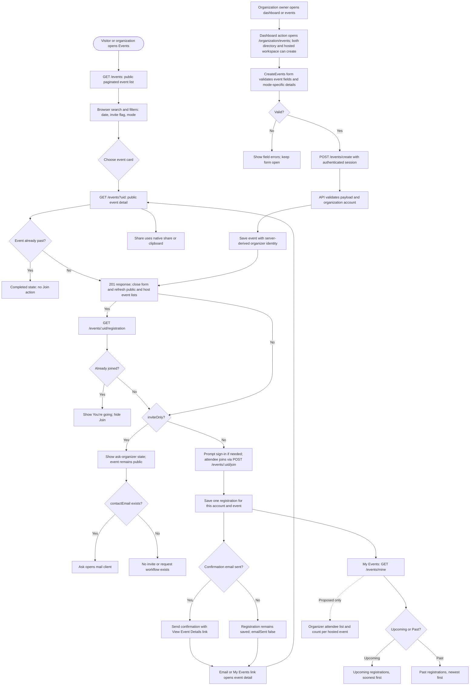

# Events

Covers the events directory, the shared event-creation form and its retired legacy predecessor, and the event display components.

## Event lifecycle: agent reference

This section records the current end-to-end behavior, including the gaps that matter when changing the module.
The Events page is public: visitors fetch `GET /events`, search and filter the returned events in the browser, then open `/events/:eventId` from an event card.
Event detail fetches `GET /events?uid={uid}` and renders the event, organizer, mode-specific location or online information, and any optional detail fields present on the record.
Past events show a completed state, with no join action.
Upcoming events marked `inviteOnly` remain visible in the public directory and detail page; the detail page replaces Join with “ask the organizer.”
There is no invitation list, invite delivery, access check, or approval flow, so `inviteOnly` is currently a display flag rather than private access control.
For an upcoming event that is not invite-only, Join requires a signed-in account and saves one registration per account.
Production sends the attendee a confirmation email; local development suppresses delivery.
Event detail checks the signed-in account's registration on load and shows “You are going” in place of Join when already registered.
No capacity or attendee-count endpoint exists, so attendee totals and available spots must not be invented.
Share uses the browser share sheet or clipboard, and Ask opens a mail link only when the event has a contact email.
Organizations can find their hosted events at `/organization/events` and on their public organization profile, both backed by `GET /events?host={handle}`.
Individual attendees can find saved registrations at `/events/mine`, linked from the signed-in Profile menu and backed by authenticated `GET /events/mine?period=upcoming|past`.
Organizers can view events they host at `/organization/events`, but cannot see registrations, attendee names, or counts; an organizer attendance dashboard remains proposed work.

### Publishing path and implementation boundary

The backend supports publishing through authenticated `POST /events/create`, validates the event, verifies the account is an organization, stores the record with the authenticated organization's identity, and returns `201`.
Organization owners can create events from the public `/events` directory or the hosted-event workspace at `/organization/events`.
The dashboard's create/manage action opens the hosted-event workspace, where `CreateEvents.tsx` opens the shared creation form.
The public directory shows its creation action from Redux's authenticated organization state, without trying to read the HTTP-only `Token` cookie in browser JavaScript.
The shared form submits to authenticated `POST /events/create` through `useEvent.ts` and refreshes both the public directory and the current organization's hosted-event list after success.
The old `CreateEvent.tsx` component remains as unused legacy code and must not be reconnected; it calls `PATCH /user/update` instead of creating an event.
The create endpoint currently accepts the basic event fields and `inviteOnly`; most long-form detail fields shown by the detail page are not accepted by its request schema yet.
Read the frontend deep spec at [events/SPEC.md](../../apps/web/src/features/events/SPEC.md), the backend spec at [apps/api/docs/specs/events.md](../../apps/api/docs/specs/events.md), and the route cross-reference at [apps/api/docs/specs/api-contract.md](../../apps/api/docs/specs/api-contract.md) before changing this path.

The dashed organizer attendee view is a product proposal, not current behavior.
Today the host event list includes event records only, and there is no organizer-facing registration query or attendee count.
The attendee experience is end to end: successful join persists the registration independently of email delivery, and opening a confirmation or My Events link loads registration state so an existing attendee sees “You're going” instead of Join.

## `Events.tsx` — routed at `/events`

[apps/web/src/features/events/pages/Events.tsx](../../apps/web/src/features/events/pages/Events.tsx).
Renders `<ComponentHelmet type="Events" />` (fixed August 2026 — previously passed `"Organizations"`, a copy-paste leftover that showed the Organizations SEO copy instead of the `"Events"` branch `ComponentHelmet` already had; see [layout-navigation.md](./layout-navigation.md)), `<Navbar />`, a page heading, the shared `DirectoryToolbar` (search, an Upcoming/Past `FilterDropdown` plus a second invite/mode `FilterDropdown` via its `secondaryFilter` prop, live result count, primary button), one flat grid of `<EventCard />` with an empty state, and `<Footer />`.

**Live data, September 2026.** `GET /events` (`eventEndpoints.directory()`, a generous `limit=100` — the route has no server-side search filter to send, see below) via `useSWR`, mapped through [utils/toDisplayEvent.ts](../../apps/web/src/features/events/utils/toDisplayEvent.ts) into the looser `EventCardEvent` shape `EventCard` actually needs. Replaces the twelve-event fixture that used to live in `constants/eventDirectory.ts` — that file, its `constants/eventDetails.ts` companion, and their placeholder cover photos are deleted outright, not just unused, now that `DetailedEvent.tsx` is live too (see that page's section below).

Two real, deliberate differences from `/organizations`' directory, both because an event has a date and an organization doesn't:
- **The primary filter dropdown's taxonomy is Upcoming/Past, not a cause taxonomy.** A live `Event` has no cause field at all ([event.model.ts](../../apps/api/src/modules/events/event.model.ts)) — inventing one the way the old fixture did would be exactly the kind of fabricated-but-unlabelled data this rewrite exists to remove. "What's happening soon" is also just the more useful question for an events page to answer than a cause split ever was.
- **A second filter dropdown** (`TypeFilter` - `"All" | "Invite only" | "Open to all" | "Online" | "Offline"`, September 2026) narrows by two real `Event` fields, `inviteOnly` and `mode`. It's one flat single-select list, not two independently-combinable dropdowns or a multi-select - picking one clears the others, so "online" and "invite only" can't be filtered together today; see `Events.tsx`'s own `TypeFilter` comment for why that tradeoff was made over a heavier multi-select `FilterDropdown` variant that doesn't exist yet. Wired into `DirectoryToolbar` via a new optional `secondaryFilter` prop, since the component previously supported exactly one filter dimension (see [08-components-shared.md](./design-system/08-components-shared.md#directorytoolbar)).

**Results render as one flat grid (September 2026), not grouped by day.** Until September 2026 results were bucketed into same-day sections (`utils/groupEventsByDay.ts`, now deleted) - "Today"/"Tomorrow"/"Yesterday", else a full weekday+date. With the seed data's actual date spread, most day-sections held exactly one event, so the headers added visual structure without adding real information; `EventCard`'s own cover-photo date badge already tells a visitor which day an event falls on. Sort direction still flips with the time filter: soonest-first for Upcoming, most-recent-first for Past.

`GET /events` (`listEventsQuerySchema`, apps/api) only knows `uid`/`slug`/`host`/pagination — no `search` or domain param the way `GET /organizations` has — so the text search, the Upcoming/Past split and the type filter all run client-side over the one fetched page, not sent to the backend. Acceptable at today's scale; would need a real backend filter (or real pagination-aware fetching) if the directory grows past what one `limit=100` page holds.

**`EventCard` now handles a live record's real gaps rather than a fixture that had none:** no cover photo → an accent-gradient block with a calendar mark (same derivation as `OrganizationCard`'s no-cover fallback); no `organizerHandle` (an individual host, per `event.model.ts`) → the organizer name renders as plain text instead of a link; no capacity data → the "N going / spots left" rule at the bottom is omitted entirely rather than showing invented numbers (see [known-issues.md](./known-issues.md#events--rsvp-and-attendee-capacity-future-scope-deliberately-not-built) — real capacity tracking is future scope, not built).

**September 2026:** two badge pills — "Govt" (`event.isGovernmentSponsored`) and "Invite only" (`event.inviteOnly`) — render top-right on the cover, in the slot `OrganizationCard`'s "Featured" pill uses, when the underlying `Event` document carries either flag. The meta row's vertical spacing was also loosened and its date/time line's icon changed from a repeated `FiCalendar` to `FiClock`, so the date badge and the time line read as two distinct facts rather than the same one twice.

Event creation is available to signed-in organization accounts from the public directory and hosted-event workspace.
The directory checks Redux login state and `userType === "organization"`; it does not read the HTTP-only `Token` cookie from browser JavaScript.
Personal accounts and signed-out visitors see no creation button or modal; browsing, search, and filters remain public.
The API independently rejects personal-account creation requests with `403`, using the stored account type.
`e2e/events/events-responsive.spec.ts` covers the public directory's Upcoming/Past filtering and responsive layout; event creation and My Events currently have no browser coverage.

**Width fixed to `max-w-6xl` (September 2026).** Both content wrappers here were `max-w-7xl`, wider than `Navbar` and every other page's container — the identical drift `/organizations` had, from the same original pass. Full explanation: [organizations.md](./organizations.md), [layout-navigation.md](./layout-navigation.md#navbar).

## `YourEvents.tsx` — the organization's own events

[apps/web/src/features/events/pages/YourEvents.tsx](../../apps/web/src/features/events/pages/YourEvents.tsx), routed at `/organization/events` (August 2026).
This is where the navbar's "Your events" points and where organization owners create and manage hosted events.

Two things make it different from the `/events` directory above it:

- **It is behind `OrganizationSetupGate`** ([organizations.md](./organizations.md#the-setup-flow--organizationsetup)) — a draft organization is told what is still missing and handed a link that resumes setup, rather than shown an events page it cannot yet use.
- **It renders live records, not the fixture.** It fetches `GET /events?host={handle}`, a filter added to the API in the same change, so filtering happens server-side and nothing is hidden on page two.

It deliberately renders hosted events as owner-focused rows instead of reusing the public directory card.
Its "Create event" action opens the shared `CreateEvents.tsx` form.

## `MyEvents.tsx` — an attendee's joined events

[apps/web/src/features/events/pages/MyEvents.tsx](../../apps/web/src/features/events/pages/MyEvents.tsx), routed at `/events/mine` behind `RequireSignIn` and linked from the individual account's Profile menu.
It fetches the current account's registrations from authenticated `GET /events/mine`, paginates in batches of 100, and sends the selected period to the API so both tabs page and sort independently.
Cards show the event, organizer, date, location or online platform, and a "You're going" status; each opens the event's live detail page.
Loading, fetch failure, no registrations, and empty time-period states are handled explicitly.
The older `UserProfile.tsx` has a static mock carousel but remains unrouted; it is not the implementation used by this feature.

The empty state depends on the signed-in account's saved registrations.
It does not imply that event creation is the only way registrations can exist.

## Event creation components

Two differently implemented event forms remain in the source tree, but only one is connected to a live route:

### `CreateEvent` (retired legacy component)
[apps/web/src/features/events/components/CreateEvent.tsx](../../apps/web/src/features/events/components/CreateEvent.tsx).
A retired generic dropzone-based form (cover image preview, name, description, contact details, mode, and address fields) — structurally copied from the profile editor.
Its `validateForm()` calls **`updateUserProfile(...)`** (`PATCH /user/update`), not an event-creation endpoint — this form does not actually create an event; it patches the user's own profile with whatever was typed into the "event" fields.
This looks like `ProfileUpdate.tsx` was duplicated as a starting point for event creation and the API call was never swapped out.
Several address-block inputs bind to the wrong `credentials.address.*` keys (e.g. the "City"/"State" row and the "Address Line 1/2" row both read/write `line1`/`line2` instead of `city`/`state` — copy-paste from the row above them).
This component is not mounted and must stay retired; do not reconnect it.

### `CreateEvents` (shared, used by directory and organizer workspace)
[apps/web/src/features/events/components/CreateEvents.tsx](../../apps/web/src/features/events/components/CreateEvents.tsx).
A MUI form for event name, date/time, mode, unique ID, description, cover upload, and mode-specific location or meeting details.
It is mounted on both `/events` for authenticated organization accounts and `/organization/events` for the host workspace.
Validation and submission go through [useEvent](../../apps/web/src/features/events/hooks/useEvent.ts), which calls the real `POST /events/create` API function.

The retired component is documented so it is not accidentally reconnected; all live creation work belongs in the shared `CreateEvents` form and `useEvent` hook.

## `useEvent` hook

[apps/web/src/features/events/hooks/useEvent.ts](../../apps/web/src/features/events/hooks/useEvent.ts) — pairs with `CreateEvents` (the MUI one, not `CreateEvent`).
`validateEvent()` checks required fields, mode-specific fields, name and description lengths, and the combined start/end date and time order.
Submission receives the exact validation result for the current form, avoiding stale closure state.
Before sending, it combines each selected date and clock time into the API's `startTime` and `endTime` timestamps and sends date-only values in `startDate` and `endDate`.
On success (`response.status === 201`), it shows a success toast, closes the modal, and revalidates both `eventEndpoints.directory()` and the current organization's `eventEndpoints.byHost()` key.

## Event display components

- [EventsMarqueeCards.tsx](../../apps/web/src/features/events/components/EventsMarqueeCards.tsx) — takes an `event` prop and renders its cover, name, location or online platform, and start date/time. It is not rendered by a current route; its future placement remains undecided.
- [EventCard.tsx](../../apps/web/src/features/events/components/EventCard.tsx) — the card in the `Events.tsx` grid, typed against `EventCardEvent` (`types/interfaces.ts`). It renders a 16:9 cover or fallback, a date badge, one-line title, two-line summary, and event metadata. Live event records have no cause or capacity values, so the card does not show a cause label or attendee count. The badge carries the day ("12 SEP") and the meta row carries weekday and time ("Sat · 9:00 pm"). **The whole card links to `/events/:eventId`**, via a stretched overlay on the title link (`after:absolute after:inset-0`) rather than an `<a>` around everything. The organizer link remains separately clickable. Carries `data-reveal`; `Events.tsx` scopes `useSectionReveal` to the grid so cards fade in on scroll and re-reveal when a filter changes. See [ui-kit.md](./ui-kit.md#motion).
  Until August 2026 it accepted no props at all and hardcoded every field, so all twenty cards were byte-for-byte identical. The old `DirectoryEvent` fixture type and its capacity values were removed when the detail page moved to live records; no current event view has attendee-count or spots-left data.

**Net effect:** the `/events` directory and the event detail page reflect real backend data, and organization owners can create events from either the directory or hosted-event workspace. The shared form sends `POST /events/create` and refreshes both event lists after success.

## `DetailedEvent.tsx` — routed at `/events/:eventId`

[apps/web/src/features/events/pages/DetailedEvent.tsx](../../apps/web/src/features/events/pages/DetailedEvent.tsx).
The page an `EventCard` opens. Until August 2026 it was a one-line placeholder (`
DetailedEvent
`) with no route at all; until September 2026 it was routed but read a twelve-event fixture that the live directory's cards had already stopped linking to, so every real event's card led here to a not-found state instead of a detail page.

**Live data, September 2026.** `:eventId` is a real event's `uid`. `useSWR<ApiEvent>(eventId ? eventEndpoints.byUid(eventId) : null, fetcher)` fetches `GET /events?uid={id}` — reusing the backend's existing single-event branch rather than adding a dedicated route — and `utils/toDisplayEventDetail.ts` maps the result onto the `{ event, detail }` shape this page renders, the same loading/not-found/view three-way branch `OrganizationProfile.tsx` already uses. The old fixture files (`constants/eventDirectory.ts`/`eventDetails.ts`) and their placeholder cover photos are deleted.

**`event.model.ts` grew the fields this page needs**, in the same change that wired the fetch: long-form `about`, a structured `agenda` (the run sheet), `bringAlong`, mode-specific `gettingThere`/`linkDelivery`/`joinRequirements`, an optional `cost`, an optional `fundraiser`, `languages`, `minimumAge`, `contactEmail` — plus two flags. `isGovernmentSponsored` is a trust badge, server/seed-set only (mirrors `Organization.verified` exactly — self-declaring it would be trivially fake-able), rendered by `EventHero` as a brand-tinted pill. `inviteOnly` is organizer-settable; when set, `EventJoinPanel` replaces the Join control with an honest "ask the organizer" state instead of a control that would look live and do nothing useful, and `EventFacts`'s "Who can come" cell reports it directly.

**Content, top to bottom:** `EventHero` (the same cover photo as the card, so arriving reads as that card opening; the two badge pills when set; title, organizer link, then when / how long / where), then a two-column body — main column: About (only if `about` is non-empty), a four-cell fact strip (`EventFacts`, degrading gracefully per-cell rather than disappearing), the run sheet (`EventAgenda`, only if `agenda` is non-empty), venue-or-joining (`EventLocationPanel`, which itself renders nothing if there's genuinely no address/platform to show), and what to bring (only if `bringAlong` is non-empty); sidebar: the join panel (`EventJoinPanel`) and, only where the event raises money, `EventFundraiserPanel`.
On a phone the sidebar renders *first* (`order-1`/`order-2`, one control and one piece of state — not a second copy), because "can I go, and what does it cost" outranks the reading on a narrow screen.

**The join CTA stays reachable while reading, September 2026 (`EventMobileActionBar`).** `EventJoinPanel` being first on a phone still means it scrolls away the moment someone reads past it into About/Details/Agenda/Location/Bring-along — on a long event page that's most of the scroll. Below `lg`, [EventMobileActionBar](../../apps/web/src/features/events/components/detail/EventMobileActionBar.tsx) mirrors just the primary action — cost (or "Free"), spots-left when tracked, and the one Join/Ask button — in a floating "liquid glass" capsule fixed near the bottom of the viewport (heavy `backdrop-blur`/`backdrop-saturate`, translucent, inset from the screen edges by the same margin as `EventHero`/`EventJoinPanel` above it, opaque button on top), matching the pattern mobile ticketing/registration apps (Meetup, Finimize, Shopee) use for the same problem. It shares `DetailedEventView`'s `joined` state with `EventJoinPanel` rather than keeping a second copy.
It only shows once it's actually needed: `hidden` in `DetailedEventView` is gated by two independent checks, deliberately using two different mechanisms. Whether `EventJoinPanel` itself is on screen (the bar stays out of the way while the real Join button is still visible; an early version showed both at once right after the hero, an exact duplicate control caught in review) is a genuine `IntersectionObserver` — a plain "is it currently visible" question, which is exactly what that API answers. Whether the footer has been reached is **not** — that's a one-way threshold ("still true for every scroll position past this point," not "true only while a sentinel is crossing"), and `IntersectionObserver` only calls back when `isIntersecting` itself flips; verified live, scrolling from deep in the footer back up skipped straight from "sentinel above the viewport" to "sentinel below it" without ever reporting `true` in between, leaving the bar stuck hidden. That one instead reads the sentinel's `getBoundingClientRect()` directly off a rAF-throttled native `scroll` listener — the same idea as `BackToTop.tsx`'s own "scrolled past 250px" check, immediate rather than debounced since a stale value here means the bar sitting on the footer, not just a late-appearing button. At `lg` and up the bar renders nothing (`lg:hidden`) — the sidebar copy is already `sticky`, so there's nothing to solve.

**Translate distance, not `translate-y-full`.** The bar floats with a real `bottom` gap rather than sitting flush at `bottom-0`, so hiding it by translating down exactly its own height (what `translate-y-full` does) leaves that gap's worth of it still inside the viewport — verified live as a persistent sliver of the "Join event" button poking up over the footer's dark newsletter band, the glass-bar "glitch" this section exists to record. The hidden state translates by the bar's own height plus a flat `4rem`, comfortably past the largest real gap it ever sits at (`0.75rem` plus a notched iPhone's `safe-area-inset-bottom`, ~46px worst case).

**Cost is a first-class fact and free is the default.** `cost` is *omitted* on the model for a free event rather than set to zero — almost every event here is a nonprofit drive — so the free case says "Free to attend / Nonprofit event. Nothing to pay, ever." in words.

**Attendee capacity is deliberately not tracked.** `going`/`spotsLeft` stay `undefined` on every live event — same "nothing invented" rule the directory card follows. `EventFacts`'s "Attendance" cell and `EventJoinPanel`'s Going/Spots-left row are omitted when the event has no capacity data. See [known-issues.md](./known-issues.md#events--rsvp-and-attendee-capacity-future-scope-deliberately-not-built) for what real RSVP/capacity tracking would need — flagged as future scope, not scheduled.

**Joining writes a registration; contribution is not implemented.** The attendee state comes from saved registrations, not local component state:
- Join calls authenticated `POST /events/:uid/join`; the API saves one registration for the caller and event, then sends the confirmation email only in production.
  In development and test, delivery is suppressed and the API reports `emailSent: false`.
  The joined state is verified through `GET /events/:uid/registration` on page load, so returning from email or My Events shows “You are going” and hides the Join action.
  Capacity remains untracked, and no attendee count is derived from saved registrations.
- Contribute toasts "contributions open here soon".
- Share uses `navigator.share` where it exists and the clipboard otherwise; a dismissed share sheet (`AbortError`) is not treated as an error.
- The venue's map is a plain Google Maps *search link*, not an embed — an iframe would mean a third-party script and a cookie banner for one address.

## `HostedEvents` (empty stub)

- [apps/web/src/features/events/components/HostedEvents.tsx](../../apps/web/src/features/events/components/HostedEvents.tsx) — file exists but is **completely empty** (0 bytes); importing it would fail.

## Types

This entire folder is TypeScript. See [events/SPEC.md](../../apps/web/src/features/events/SPEC.md#types) for the full breakdown, including which pre-existing bugs (the `EventCard` prop mismatch, `CreateEvent`'s stray `htmlFor` on a `div`) now surface as suppressed compile errors.

## Refreshing local demo events

Demo event dates are relative to when the seed script runs, so an old seed can leave the default Upcoming view empty even while the API returns events.
From `apps/api`, run `pnpm exec tsx scripts/seed-demo-data.ts --events-only` to refresh only the known demo event records in the configured database.
This upserts the demo events with fresh relative dates, including future and past examples, without changing users, organizations, products, reports, or non-demo events.
The directory keeps its normal date filters; past records belong under Past.
