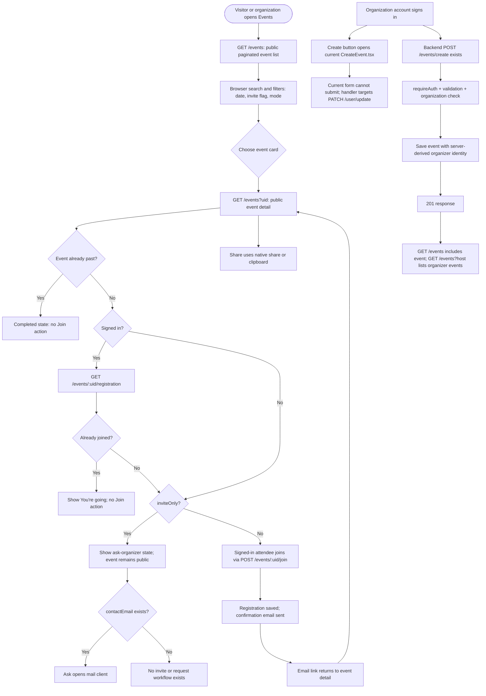

# Events

Covers the events directory page, the (two, redundant) event-creation modals, and the various event card/slider components.

## Event lifecycle: agent reference

This section records the current end-to-end behavior, including the gaps that matter when changing the module.
The Events page is public: visitors fetch `GET /events`, search and filter the returned events in the browser, then open `/events/:eventId` from an event card.
Event detail fetches `GET /events?uid={uid}` and renders the event, organizer, mode-specific location or online information, and any optional detail fields present on the record.
Past events show a completed state, with no join action.
Upcoming events marked `inviteOnly` remain visible in the public directory and detail page; the detail page replaces Join with “ask the organizer.”
There is no invitation list, invite delivery, access check, or approval flow, so `inviteOnly` is currently a display flag rather than private access control.
For an upcoming event that is not invite-only, Join requires a signed-in account and saves one registration per account. The attendee receives a confirmation email; event detail checks the signed-in account's registration on load and shows “You are going” in place of Join when already registered.
No capacity or attendee-count endpoint exists, so attendee totals and available spots must not be invented.
Share uses the browser share sheet or clipboard, and Ask opens a mail link only when the event has a contact email.
Organizations can find their hosted events at `/organization/events` and on their public organization profile, both backed by `GET /events?host={handle}`.

### Publishing path and implementation boundary

The backend supports publishing through authenticated `POST /events/create`, validates the event, verifies the account is an organization, stores the record with the authenticated organization's identity, and returns `201`.
The public Events page's Create An Event button currently opens `CreateEvent.tsx`, whose Save button cannot become enabled and whose submit handler calls `PATCH /user/update`; it does not publish an event.
The functional form and hook pair are `CreateEvents.tsx` and `useEvent.ts`, but that component is not mounted by any routed page.
When wiring the organizer flow, use the real `POST /events/create` contract and refresh the exact `eventEndpoints.directory()` SWR key after success so the newly published event appears in the public directory.
The create endpoint currently accepts the basic event fields and `inviteOnly`; most long-form detail fields shown by the detail page are not accepted by its request schema yet.
Read the frontend deep spec at [events/SPEC.md](../../apps/web/src/features/events/SPEC.md), the backend spec at [apps/api/docs/specs/events.md](../../apps/api/docs/specs/events.md), and the route cross-reference at [apps/api/docs/specs/api-contract.md](../../apps/api/docs/specs/api-contract.md) before changing this path.

## `Events.tsx` — routed at `/events`

[apps/web/src/features/events/pages/Events.tsx](../../apps/web/src/features/events/pages/Events.tsx).
Renders `<ComponentHelmet type="Events" />` (fixed August 2026 — previously passed `"Organizations"`, a copy-paste leftover that showed the Organizations SEO copy instead of the `"Events"` branch `ComponentHelmet` already had; see [layout-navigation.md](./layout-navigation.md)), `<Navbar />`, a page heading, the shared `DirectoryToolbar` (search, an Upcoming/Past `FilterDropdown` plus a second invite/mode `FilterDropdown` via its `secondaryFilter` prop, live result count, primary button), one flat grid of `<EventCard />` with an empty state, and `<Footer />`.

**Live data, September 2026.** `GET /events` (`eventEndpoints.directory()`, a generous `limit=100` — the route has no server-side search filter to send, see below) via `useSWR`, mapped through [utils/toDisplayEvent.ts](../../apps/web/src/features/events/utils/toDisplayEvent.ts) into the looser `EventCardEvent` shape `EventCard` actually needs. Replaces the twelve-event fixture that used to live in `constants/eventDirectory.ts` — that file, its `constants/eventDetails.ts` companion, and their placeholder cover photos are deleted outright, not just unused, now that `DetailedEvent.tsx` is live too (see that page's section below).

Two real, deliberate differences from `/organizations`' directory, both because an event has a date and an organization doesn't:
- **The primary filter dropdown's taxonomy is Upcoming/Past, not a cause taxonomy.** A live `Event` has no cause field at all ([event.model.ts](../../apps/api/src/modules/events/event.model.ts)) — inventing one the way the old fixture did would be exactly the kind of fabricated-but-unlabelled data this rewrite exists to remove. "What's happening soon" is also just the more useful question for an events page to answer than a cause split ever was.
- **A second filter dropdown** (`TypeFilter` - `"All" | "Invite only" | "Open to all" | "Online" | "Offline"`, September 2026) narrows by two real `Event` fields, `inviteOnly` and `mode`. It's one flat single-select list, not two independently-combinable dropdowns or a multi-select - picking one clears the others, so "online" and "invite only" can't be filtered together today; see `Events.tsx`'s own `TypeFilter` comment for why that tradeoff was made over a heavier multi-select `FilterDropdown` variant that doesn't exist yet. Wired into `DirectoryToolbar` via a new optional `secondaryFilter` prop, since the component previously supported exactly one filter dimension (see [08-components-shared.md](./design-system/08-components-shared.md#directorytoolbar)).

**Results render as one flat grid (September 2026), not grouped by day.** Until September 2026 results were bucketed into same-day sections (`utils/groupEventsByDay.ts`, now deleted) - "Today"/"Tomorrow"/"Yesterday", else a full weekday+date. With the seed data's actual date spread, most day-sections held exactly one event, so the headers added visual structure without adding real information; `EventCard`'s own cover-photo date badge already tells a visitor which day an event falls on. Sort direction still flips with the time filter: soonest-first for Upcoming, most-recent-first for Past.

`GET /events` (`listEventsQuerySchema`, apps/api) only knows `uid`/`slug`/`host`/pagination — no `search` or domain param the way `GET /organizations` has — so the text search, the Upcoming/Past split and the type filter all run client-side over the one fetched page, not sent to the backend. Acceptable at today's scale; would need a real backend filter (or real pagination-aware fetching) if the directory grows past what one `limit=100` page holds.

**`EventCard` now handles a live record's real gaps rather than a fixture that had none:** no cover photo → an accent-gradient block with a calendar mark (same derivation as `OrganizationCard`'s no-cover fallback); no `organizerHandle` (an individual host, per `event.model.ts`) → the organizer name renders as plain text instead of a link; no capacity data → the "N going / spots left" rule at the bottom is omitted entirely rather than showing invented numbers (see [known-issues.md](./known-issues.md#events--rsvp-and-attendee-capacity-future-scope-deliberately-not-built) — real capacity tracking is future scope, not built).

**September 2026:** two badge pills — "Govt" (`event.isGovernmentSponsored`) and "Invite only" (`event.inviteOnly`) — render top-right on the cover, in the slot `OrganizationCard`'s "Featured" pill uses, when the underlying `Event` document carries either flag. The meta row's vertical spacing was also loosened and its date/time line's icon changed from a repeated `FiCalendar` to `FiClock`, so the date badge and the time line read as two distinct facts rather than the same one twice.

Event creation requires a signed-in organization account: the `Token` cookie, Redux login state, and `userType === "organization"` must all be present.
Personal accounts and signed-out visitors see neither the creation button nor its modal; browsing, search, and filters remain public.
The API independently rejects personal-account creation requests with `403`, using the stored account type.
No `e2e/events/` suite exists yet; this visibility rule has no automated browser coverage.

The "Create An Event" button opens `CreateEvent` from [apps/web/src/features/events/components/CreateEvent.tsx](../../apps/web/src/features/events/components/CreateEvent.tsx) — unchanged, still the non-functional one (see below).

**Width fixed to `max-w-6xl` (September 2026).** Both content wrappers here were `max-w-7xl`, wider than `Navbar` and every other page's container — the identical drift `/organizations` had, from the same original pass. Full explanation: [organizations.md](./organizations.md), [layout-navigation.md](./layout-navigation.md#navbar).

## `YourEvents.tsx` — the organization's own events

[apps/web/src/features/events/pages/YourEvents.tsx](../../apps/web/src/features/events/pages/YourEvents.tsx), routed at `/organization/events` (August 2026).
This is where the navbar's "Your events" points; it used to point at `/event/create`, a path no route has ever matched, so the menu item was a 404 for every organization that clicked it.

Two things make it different from the `/events` directory above it:

- **It is behind `OrganizationSetupGate`** ([organizations.md](./organizations.md#the-setup-flow--organizationsetup)) — a draft organization is told what is still missing and handed a link that resumes setup, rather than shown an events page it cannot yet use.
- **It renders live records, not the fixture.** It fetches `GET /events?host={handle}`, a filter added to the API in the same change, so filtering happens server-side and nothing is hidden on page two.

It deliberately does **not** use `EventCard`: the card needs a cover photo, a cause and a capacity, and a live event record (`ApiEvent`, mirroring the API's `IEvent`) has none of the three. Plain rows are what the data actually supports. When those fields exist on a real event, this page and the directory can converge on the card.

Event creation is still broken (see below), so in practice this page shows its empty state — which is honest, rather than a fixture pretending otherwise.

## Two different "create event" components (pick carefully)

There are **two separate, differently-implemented "create an event" modals** in this codebase, and they are used in different places:

### `CreateEvent` (shared, used by `Events.tsx`)
[apps/web/src/features/events/components/CreateEvent.tsx](../../apps/web/src/features/events/components/CreateEvent.tsx).
A generic dropzone-based form (cover image preview, name, description with a 500-char counter, contact number/email, an "Online"/"Offline" radio-style mode picker, and address line1/line2/city/state/country/pincode inputs) — structurally identical to `ProfileUpdate.tsx`/`ProfileCompletion.tsx`, reusing the same CSS class naming convention (`createevent_*`).
Its `validateForm()` calls **`updateUserProfile(...)`** (`PATCH /user/update`), not an event-creation endpoint — this form does not actually create an event; it patches the user's own profile with whatever was typed into the "event" fields.
This looks like `ProfileUpdate.tsx` was duplicated as a starting point for event creation and the API call was never swapped out.
Several address-block inputs bind to the wrong `credentials.address.*` keys (e.g. the "City"/"State" row and the "Address Line 1/2" row both read/write `line1`/`line2` instead of `city`/`state` — copy-paste from the row above them).
Treat this component as **not functional** for its stated purpose; if asked to fix event creation from `/events`, the more complete implementation to build from is `CreateEvents` (below), not this one.

### `CreateEvents` (private, used by the events dashboard flow)
[apps/web/src/features/events/components/CreateEvents.tsx](../../apps/web/src/features/events/components/CreateEvents.tsx).
A much more complete, MUI-based form: event name, MUI `DatePicker`/`TimePicker` (via `dayjs`) for start/end date+time, an event-mode `<Select>` (Online/Offline), a unique event ID (`uid`) field, description, a cover-image upload converted to base64 via [convertToBase64.ts](../../apps/web/src/features/events/utils/convertToBase64.ts), and mode-dependent accordion sections: Offline shows city/state/address/country (`<Select>` populated from [static/CountryList.ts](../../apps/web/src/statics/CountryList.ts))/map-iframe fields; Online shows a platform `<Select>` (populated from [static/OnlinePlatform.ts](../../apps/web/src/statics/OnlinePlatform.ts): Zoom/Google Meet/Microsoft Teams/etc., each with an icon) and a platform-link field.
Validation and submission go through the [useEvent](../../apps/web/src/features/events/hooks/useEvent.ts) hook (see below), which does call the real `CreateEvent` API function (`KarmaCircleApi.ts`, `POST /events/create`).
This component is not currently rendered from anywhere reachable in the app — it lives under `features/events/components/` but no page imports it.

**If asked to "add event creation," clarify which of these two the request means** — they are unrelated implementations that happen to share a similar name.

## `useEvent` hook

[apps/web/src/features/events/hooks/useEvent.ts](../../apps/web/src/features/events/hooks/useEvent.ts) — pairs with `CreateEvents` (the MUI one, not `CreateEvent`).
`validateEvent()` checks all required fields are present (name, uid, description, coverImage, mode, start/end date+time, plus mode-specific fields), then separately checks `name` length (10–80), `description` length (20–200), and that `endDate >= startDate` / `endTime >= startTime`.
Note: the length/date-order checks run unconditionally, even if the earlier required-field checks already populated `errors` for a different reason, and even when `data.name`/`data.description` are empty strings (`"".length < 10` is true, so this still works, just via `.length` on an empty string rather than an explicit early return).
`submitCallback(event, setshowCreateModal)` only proceeds if `Object.keys(errors).length === 0` — but `errors` here is a variable captured once from the hook's own module scope, populated by the *previous* call to `validateEvent()`, not necessarily the errors from validating the `event` object being submitted right now; call `validateEvent()` immediately before `submitCallback` (as `CreateEvents.tsx`'s `handleSubmit` does) to keep them in sync.
On success (`response.status === 201`): success toast, closes the modal, and calls SWR's `mutate(eventEndpoints.all)` to invalidate the events list cache. Still effectively inert as of September 2026, though for a new reason: `Events.tsx` now fetches `eventEndpoints.directory()` (`${API}/events?limit=100`), a different literal string/cache key than `eventEndpoints.all` (`${API}/events`) — SWR keys match exactly, so this `mutate` call wouldn't invalidate the directory's cache even if this creation flow were reachable (it isn't — `CreateEvents.tsx`, the component this hook pairs with, still isn't rendered from any page). Worth fixing in the same change that finally wires event creation up.

## Event display components

- [EventsMarqueeCards.tsx](../../apps/web/src/features/events/components/EventsMarqueeCards.tsx) — takes an `event` prop, renders cover image, name, and either a location (Offline) or a platform icon+name (Online), plus a formatted start date/time (via [getFormattedDate.ts](../../apps/web/src/features/events/utils/getFormattedDate.ts)). Responsive text truncation at `window.innerWidth <= 500`. Not currently rendered by any page — looks intended for a "recent events" marquee (there's a commented-out `<Marquee>` block in `Profile.tsx` that would have used something like this).
- [EventCard.tsx](../../apps/web/src/features/events/components/EventCard.tsx) — the card in the `Events.tsx` grid, typed against the looser `EventCardEvent` (`types/interfaces.ts`), not the fixture-complete `DirectoryEvent` — see the `Events.tsx` section above for why. The same card as `OrganizationCard` and the landing page's drives rail — 16:9 cover, cause label on a scrim, one-line title, two-line summary on a fixed box — plus a date badge on the cover. The badge carries the day ("12 SEP") and the meta row carries only weekday and time ("Sat · 9:00 pm"), so the two don't print the same date twice as they did until August 2026. **The whole card links to `/events/:id`**, via a stretched overlay on the title link (`after:absolute after:inset-0`) rather than an `<a>` around everything — one accessible name for the destination, with the organizer link (which points somewhere else entirely) still clickable on top of it via `relative z-1`. Carries `data-reveal`; `Events.tsx` scopes `useSectionReveal` to the grid so cards fade in on scroll and re-reveal when a filter changes. See [ui-kit.md](./ui-kit.md#motion).
  Until August 2026 it accepted no props at all and hardcoded every field, so all twenty cards were byte-for-byte identical. September 2026: the "N going / N spots left" rule described in earlier versions of this doc is gone for a live event (no capacity data to show — see the `Events.tsx` section above); it still renders for a fixture `DirectoryEvent` that has one, which today only means `DetailedEvent.tsx`'s own components (`EventFacts`, `EventJoinPanel`), not this card.

**Net effect:** the `/events` directory and the event detail page both now reflect real backend data end to end — the cards are real `GET /events` records with their real gaps handled rather than fixtures with invented capacity numbers, and nothing on either page claims a number that isn't real. Event creation (`useEvent` + `CreateEvents`) remains the one unwired-to-anything-reachable piece of this feature.

## `DetailedEvent.tsx` — routed at `/events/:eventId`

[apps/web/src/features/events/pages/DetailedEvent.tsx](../../apps/web/src/features/events/pages/DetailedEvent.tsx).
The page an `EventCard` opens. Until August 2026 it was a one-line placeholder (`
DetailedEvent
`) with no route at all; until September 2026 it was routed but read a twelve-event fixture that the live directory's cards had already stopped linking to, so every real event's card led here to a not-found state instead of a detail page.

**Live data, September 2026.** `:eventId` is a real event's `uid`. `useSWR<ApiEvent>(eventId ? eventEndpoints.byUid(eventId) : null, fetcher)` fetches `GET /events?uid={id}` — reusing the backend's existing single-event branch rather than adding a dedicated route — and `utils/toDisplayEventDetail.ts` maps the result onto the `{ event, detail }` shape this page renders, the same loading/not-found/view three-way branch `OrganizationProfile.tsx` already uses. The old fixture files (`constants/eventDirectory.ts`/`eventDetails.ts`) and their placeholder cover photos are deleted.

**`event.model.ts` grew the fields this page needs**, in the same change that wired the fetch: long-form `about`, a structured `agenda` (the run sheet), `bringAlong`, mode-specific `gettingThere`/`linkDelivery`/`joinRequirements`, an optional `cost`, an optional `fundraiser`, `languages`, `minimumAge`, `contactEmail` — plus two flags. `isGovernmentSponsored` is a trust badge, server/seed-set only (mirrors `Organization.verified` exactly — self-declaring it would be trivially fake-able), rendered by `EventHero` as a brand-tinted pill. `inviteOnly` is organizer-settable; when set, `EventJoinPanel` replaces the Join control with an honest "ask the organizer" state instead of a control that would look live and do nothing useful, and `EventFacts`'s "Who can come" cell reports it directly.

**Content, top to bottom:** `EventHero` (the same cover photo as the card, so arriving reads as that card opening; the two badge pills when set; title, organizer link, then when / how long / where), then a two-column body — main column: About (only if `about` is non-empty), a four-cell fact strip (`EventFacts`, degrading gracefully per-cell rather than disappearing), the run sheet (`EventAgenda`, only if `agenda` is non-empty), venue-or-joining (`EventLocationPanel`, which itself renders nothing if there's genuinely no address/platform to show), and what to bring (only if `bringAlong` is non-empty); sidebar: the join panel (`EventJoinPanel`) and, only where the event raises money, `EventFundraiserPanel`.
On a phone the sidebar renders *first* (`order-1`/`order-2`, one control and one piece of state — not a second copy), because "can I go, and what does it cost" outranks the reading on a narrow screen.

**The join CTA stays reachable while reading, September 2026 (`EventMobileActionBar`).** `EventJoinPanel` being first on a phone still means it scrolls away the moment someone reads past it into About/Details/Agenda/Location/Bring-along — on a long event page that's most of the scroll. Below `lg`, [EventMobileActionBar](../../apps/web/src/features/events/components/detail/EventMobileActionBar.tsx) mirrors just the primary action — cost (or "Free"), spots-left when tracked, and the one Join/Ask button — in a floating "liquid glass" capsule fixed near the bottom of the viewport (heavy `backdrop-blur`/`backdrop-saturate`, translucent, inset from the screen edges by the same margin as `EventHero`/`EventJoinPanel` above it, opaque button on top), matching the pattern mobile ticketing/registration apps (Meetup, Finimize, Shopee) use for the same problem. It shares `DetailedEventView`'s `joined` state with `EventJoinPanel` rather than keeping a second copy.
It only shows once it's actually needed: `hidden` in `DetailedEventView` is gated by two independent checks, deliberately using two different mechanisms. Whether `EventJoinPanel` itself is on screen (the bar stays out of the way while the real Join button is still visible; an early version showed both at once right after the hero, an exact duplicate control caught in review) is a genuine `IntersectionObserver` — a plain "is it currently visible" question, which is exactly what that API answers. Whether the footer has been reached is **not** — that's a one-way threshold ("still true for every scroll position past this point," not "true only while a sentinel is crossing"), and `IntersectionObserver` only calls back when `isIntersecting` itself flips; verified live, scrolling from deep in the footer back up skipped straight from "sentinel above the viewport" to "sentinel below it" without ever reporting `true` in between, leaving the bar stuck hidden. That one instead reads the sentinel's `getBoundingClientRect()` directly off a rAF-throttled native `scroll` listener — the same idea as `BackToTop.tsx`'s own "scrolled past 250px" check, immediate rather than debounced since a stale value here means the bar sitting on the footer, not just a late-appearing button. At `lg` and up the bar renders nothing (`lg:hidden`) — the sidebar copy is already `sticky`, so there's nothing to solve.

**Translate distance, not `translate-y-full`.** The bar floats with a real `bottom` gap rather than sitting flush at `bottom-0`, so hiding it by translating down exactly its own height (what `translate-y-full` does) leaves that gap's worth of it still inside the viewport — verified live as a persistent sliver of the "Join event" button poking up over the footer's dark newsletter band, the glass-bar "glitch" this section exists to record. The hidden state translates by the bar's own height plus a flat `4rem`, comfortably past the largest real gap it ever sits at (`0.75rem` plus a notched iPhone's `safe-area-inset-bottom`, ~46px worst case).

**Cost is a first-class fact and free is the default.** `cost` is *omitted* on the model for a free event rather than set to zero — almost every event here is a nonprofit drive — so the free case says "Free to attend / Nonprofit event. Nothing to pay, ever." in words.

**Attendee capacity is deliberately not tracked.** `going`/`spotsLeft` stay `undefined` on every live event — same "nothing invented" rule the directory card follows. `EventFacts`'s "Attendance" cell and `EventJoinPanel`'s Going/Spots-left row both render an honest "not tracked" state instead. See [known-issues.md](./known-issues.md#events--rsvp-and-attendee-capacity-future-scope-deliberately-not-built) for what real RSVP/capacity tracking would need — flagged as future scope, not scheduled.

**Nothing on this page writes anywhere.** There is no attend/RSVP or payment endpoint (see [api-integration.md](./api-integration.md)):
- Join is local component state, and only offered at all for an event that isn't invite-only. The counts move with it when capacity data exists (`going + 1`, one spot fewer, "You are going"), and the panel says in words that it is saved on the device only and the organizer has not been told. That is deliberate — a control that looks live and silently does nothing is the worse failure, and is what `Profile.tsx`'s Subscribe/Sponsor pair does.
- Contribute toasts "contributions open here soon".
- Share uses `navigator.share` where it exists and the clipboard otherwise; a dismissed share sheet (`AbortError`) is not treated as an error.
- The venue's map is a plain Google Maps *search link*, not an embed — an iframe would mean a third-party script and a cookie banner for one address.

## `HostedEvents` (empty stub)

- [apps/web/src/features/events/components/HostedEvents.tsx](../../apps/web/src/features/events/components/HostedEvents.tsx) — file exists but is **completely empty** (0 bytes); importing it would fail.

## Types

This entire folder is TypeScript. See [events/SPEC.md](../../apps/web/src/features/events/SPEC.md#types) for the full breakdown, including which pre-existing bugs (the `EventCard` prop mismatch, `CreateEvent`'s stray `htmlFor` on a `div`) now surface as suppressed compile errors.

## Refreshing local demo events

Demo event dates are relative to when the seed script runs, so an old seed can leave the default Upcoming view empty even while the API returns events.
From `apps/api`, run `pnpm exec tsx scripts/seed-demo-data.ts --events-only` to refresh only the known demo event records in the configured database.
This upserts the demo events with fresh relative dates, including future and past examples, without changing users, organizations, products, reports, or non-demo events.
The directory keeps its normal date filters; past records belong under Past.
