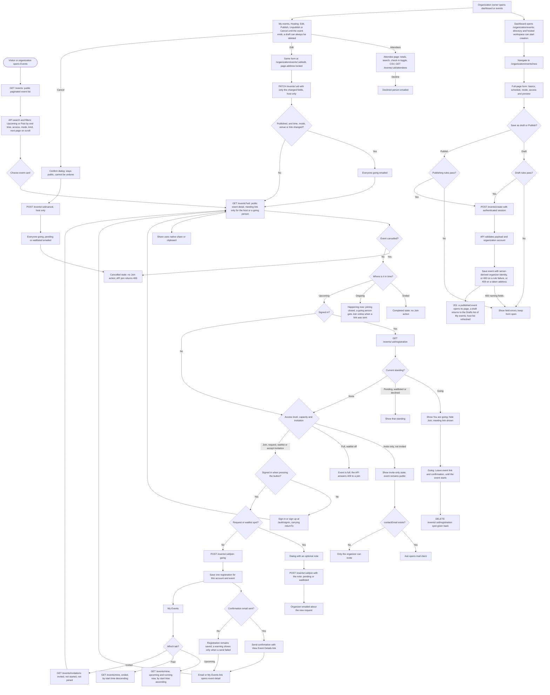

# Events

Covers the events directory, the shared event form (publish and edit, with its
optional details), cancelling an event, leaving an event, capacity, the organizer's
attendee list and check-in, and the event display components. The retired legacy form
(`CreateEvent.tsx`) was deleted in November 2026.

## Event lifecycle: agent reference

This section records the current end-to-end behavior, including the gaps that
matter when changing the module. The Events page is public: visitors fetch
`GET /events` a page of 12 at a time, with search, the Upcoming/Past split and
the type filter applied by the API, then open `/events/:eventId` from an event
card. Event detail fetches
`GET /events?uid={uid}` and renders the event, organizer, mode-specific location
or online information, and any optional detail fields present on the record.
The meeting link of an online or hybrid event is sent only to the hosting
organization and to a signed-in person who is going.
An event is judged by its **end** time (`eventPhase`, 2026-11-26): between the
start and the end it reads "Happening now" and is closed to joining, and only
after the end does it show a completed state, with no join action.
A **cancelled** event
(November 2026, PG-2) stays in the directory, on the detail page and in My Events
with a "Cancelled" label instead; its Join action is replaced by a short
explanation, and the API refuses a join with `409`. Cancelled wins over
completed: a cancelled event that has since passed is still cancelled. Upcoming
events have one of three **access levels** (November 2026, PG-4 and PG-14):
open (anyone signed in joins), approval required (anyone can ask and the
organizer approves or declines each person), or invite only (only emails the
organizer invited can join). All three stay in the public directory and on the
detail page; see "Who can join, requests and the waitlist" below. For an upcoming
open event, Join requires a signed-in account and saves one registration per
account.
A signed-out visitor who presses the button is sent to sign in or sign up and
comes back to the event.
Production sends the attendee a confirmation email; local development
suppresses delivery. Event detail checks the signed-in account's registration on
load and shows “You are going” in place of Join when already registered. An
event can have a **capacity** (November 2026, PG-5): the API reserves a spot on
join, refuses a join with `409 "This event is full."`, and returns `capacity` and
`registrationCount`; the web shows going and spots left (on the card, the facts
strip, the join panel and the mobile bar) **only for an event with a capacity**,
and "No limit" otherwise, because only a capped event has a trustworthy count.
A full event shows "Event is full" to everyone who does not already hold a place.
Someone who is going can **leave** (PG-3): a "Leave event" link under the status
line opens a confirmation, calls `DELETE /events/:uid/registration`, gives the
spot back, and the page refreshes the event and the registration state. Leaving
is only offered until the event starts (the API refuses it after).

Three more fields shape what people see (November 2026). An event's **format**
is In person, Online or **Hybrid** (PG-10): a Hybrid event has a venue and a live
stream, shows "Hybrid · City, Country" on cards and lists, and answers both "where"
and "how to join" on its page, venue first. Every event can have a **kind**
(Volunteering drive, Fundraiser, Workshop or training, Awareness campaign, Meetup or
networking, Cultural or community event, Other) and up to eight **tags** (PG-9):
the kind is a label on the card and a badge on the page, the tags are `#chips` on
the page and are matched by the directory search. An event can also be a **draft**
(PG-15): saved, but only its own organization can see it.
A draft needs much less than a published event (see "Draft rules and publishing
rules").
A draft is not in the
directory, the organization's public profile for anyone else or its dashboard (the owner sees their drafts on their own profile, in a labelled Drafts group), cannot be opened by
address by anyone else (it answers as not found), and cannot be joined; the owner
sees it in the Drafts list of My events' Hosting view and can open it with a banner saying so. Share uses the browser share
sheet or clipboard, and Ask opens a mail link only when the event has a contact
email.
Every signed-in account finds its events at `/events/mine` (My events), linked from the Profile menu.
The **Attending** view lists saved registrations (`GET /events/mine?period=upcoming|past`) and invitations (`GET /events/invitations`).
An organization also has a **Hosting** view there, and its public profile, both backed by `GET /events?host={handle}`.
The Hosting view contains event records only. The organization dashboard
shows total registrations and per-event registration counts, but not attendee
names or attendance check-in; those live on the separate attendee page above.
The organization sees **who is coming** at
`/organization/events/:eventId/attendees` (November 2026, PG-6): totals (registered
of capacity, checked in), a search on name or email, a check-in toggle per person,
a "Download CSV" button and a "Load more attendees" button (50 at a time). Only the
hosting organization can open it, and a new registration also emails the
organization owner in production. Organizations manage a hosted event from
the Hosting view: **Attendees** opens that list, **Edit** opens
the shared form at `/organization/events/:eventId/edit`, and **Cancel event**
opens a confirmation dialog and calls `POST /events/:uid/cancel`.
The API emails the people affected by a cancellation and by a material edit (see
"Emails after a change").

### Publishing path and implementation boundary

The backend supports publishing through authenticated `POST /events/create`,
validates the event, verifies the account is an organization, stores the record
with the authenticated organization's identity, and returns `201`. Organization
owners can create events from the public `/events` directory or the hosted-event
view at `/events/mine?tab=hosting`. Both actions navigate to the full-page form
at `/organization/events/new`; no event-creation modal remains in the live flow.
The dashboard's create/manage action opens the hosted-event workspace, where the
create action opens that same page. The public directory shows its creation
action from Redux's authenticated organization state, without trying to read the
HTTP-only `Token` cookie in browser JavaScript. The shared page submits to
authenticated `POST /events/create` through `useEvent.ts`, then opens the
published event detail page. The current organization's hosted-event list cache
is revalidated after success, and the public directory refetches when `/events`
is next opened. The form covers event
basics, date/time, online or in-person details, who can join, an
optional maximum number of attendees, a section of optional details (below), and
a live preview. The old `CreateEvent.tsx` component (which called
`PATCH /user/update` instead of creating an event) was deleted in November 2026.

**Editing and cancelling (November 2026, PG-1 and PG-2).** Each event in the
Hosting view that has not ended and is not cancelled has an Edit link
and a Cancel button. Edit opens `EditEvent.tsx` at
`/organization/events/:eventId/edit` (behind `RequireSignIn`), which loads the
event with `GET /events?uid=` through `useEventSnapshot` (see `EventForm` and
`EditEvent` below), checks in the browser that the signed-in
organization hosts it, and renders the same `EventForm` the create page uses,
filled in. The page address is read-only, because registrations point at it and
links people already hold must keep working. Saving sends only what changed to
`PATCH /events/:uid` (`buildEventChanges`), so the cover image is not re-sent
unless a new one was picked and a start time left alone is never re-sent. A
cancelled event, one that has ended, or a draft whose dates have passed ("This draft's dates have passed") shows an explanation instead of the form.
While the edit is dirty, leaving through an in-app link or browser Back asks for
confirmation, and closing or refreshing uses the browser's unsaved-changes prompt.
The published-event Save changes action appears in a fixed bottom bar only while
there are unsaved changes.
Edit mode presents Basics, Date & place, Attendance, and More details one at a
time; switching sections preserves current values, and validation opens the
section containing the first invalid field.
On success the page revalidates that event and the host list, shows "Event
updated" and opens the event page. Cancel opens `CancelEventDialog` (a native
`<dialog>`, with "Keep event" focused first because cancelling cannot be undone),
then calls `POST /events/:uid/cancel` and revalidates the host list. A cancelled
event stays public with a badge; there is no reinstate and no delete.
The events feature has no `services/` folder: every event API call is in
`src/services/KarmaCircleApi.ts` (writes) or goes through `useSWR` with
`eventEndpoints` (reads). The create endpoint accepts the basic event fields, `access` and
`waitlistEnabled` (the retired `inviteOnly` flag is dropped like any unknown
field), and the optional detail fields. Read the frontend deep spec at
[events/SPEC.md](../../apps/web/src/features/events/SPEC.md), the backend spec
at [apps/api/docs/specs/events.md](../../apps/api/docs/specs/events.md), and the
route cross-reference at
[apps/api/docs/specs/api-contract.md](../../apps/api/docs/specs/api-contract.md)
before changing this path.

The organizer roster and check-in (PG-6) are now built: the Attendees page in the
diagram below. The organization dashboard still shows only aggregate registration
totals and per-event counts, and the Hosting view of My events
includes event records and the Attendees, Edit and Cancel actions. The attendee experience is end to end: successful
join persists the registration independently of email delivery, and opening a
confirmation or My Events link loads registration state so an existing attendee
sees “You're going” instead of Join.

## Time, meeting link, sign-in and emails (2026-11-26)

### Upcoming, Happening now and Completed

`eventPhase(startsAt, endsAt)` in `utils/formatEventFacts.ts` is the one definition every surface shares: `upcoming` before the start, `ongoing` between the start and the end, `ended` only once the end has passed.
A record with no readable end is judged by its start alone, and one with no readable time counts as upcoming.
It replaced `isEventPast`, which called an event completed as soon as it started.
The API splits `period=upcoming` from `past` by the end time too, so Upcoming (the directory and My Events) includes events that are running.
The organization profile's hosted-events list groups by the same rule, with a Drafts group first (see below).

A running event reads "Happening now" on the card (bottom-left of the cover, which keeps its color), the hero (not on a draft), the join panel, the mobile bar, My Events and the organization profile's list.
A cancelled event never does.
Joining and leaving are closed from the start time.
The join panel shows "You are going" to a person who is going, with a "Join online" button when the API sent them a meeting link.
Everyone else, including someone whose request is pending or waitlisted, reads "Joining has closed because the event has started."
While the signed-in visitor's registration is loading the panel says so, and after a failed check it offers a retry.
The mobile bar shows the same states in short form: "Join online" ("Join" on a narrow phone), "Going", "Checking…", "Retry check" or "Closed".
The panel's date line reads "Started", and "Planned for" on a draft.
A draft shows no time badge and no time state at all, whatever its dates say.
There is no timer, so an open page does not change by itself at the start or the end (see [known-issues.md](./known-issues.md#events---open-points-2026-11-26)).

### The meeting link is not public

The API returns `platformLink` only to the hosting organization and to a signed-in person who is going (see [the API spec](../../apps/api/docs/specs/events.md#meeting-link-privacy)).
`platform`, `linkDelivery` and `joinRequirements` stay public.
Every cached API response belongs to whoever fetched it, so when the signed-in identity changes (sign in, sign up, Google, logout, a rejected session, a `401` on join, one account replacing another) all of them are dropped and the pages fetch again (see [state-management.md](./state-management.md#5-cached-responses-and-the-signed-in-identity)).
This replaced `DetailedEvent.tsx` hiding the link from a signed-out render.
The page also clears the cached link as soon as a leave succeeds, and refetches the event after a join, a refused join or a refused leave.
When an online or hybrid event has no link for the viewer, `utils/joinLinkNote.ts` supplies the sentence on the joining card:

| Viewer and event | Sentence |
| --- | --- |
| Host | "No meeting link has been added yet." |
| Going, not ended | "The meeting link is not available yet." ("Getting your meeting link…" while refetching) |
| Anyone else, upcoming | "The meeting link is shown here once you have joined." |
| Anyone else, running | "Joining has closed because the event has started, so the meeting link is not shown." |
| Cancelled, or ended and not the host | none |

The organizer's own `linkDelivery` text is shown beside it when there is one; the old default "The organizer will share the join link closer to the date." is gone.
The calendar entry of an online event carries the link only when the viewer was sent one.

### A signed-out visitor presses Join

The button looks the same as for a signed-in visitor.
When it would join, request or waitlist, pressing it navigates to `/auth/signin` with `{ returnTo: "/events/<uid>" }` in router state, and signing in or up comes back to the event (see [authentication.md](./authentication.md#returning-after-sign-in)).
Nothing is joined automatically: the visitor presses the button again.
A join answered with `401` (a saved session the API no longer accepts) resets the Redux user and takes the same route.
After sign-in or sign-up the visitor goes back to the event, except a brand-new organization signing up, which goes to `/organization/setup` (`destinationAfterAuth`).
An invite-only event, and a full event without a waitlist, have no Join button for a signed-out visitor.
They get an "Invited? Sign in" button, because an invitation gets past both (`signInPrompt` in `utils/joinView.ts`).
While an event is running, a signed-out visitor sees "Already joined? Sign in" instead, since a person who is going only sees their place and meeting link after signing in.
The mobile bar carries the same question beside a "Sign in" button.
Neither is shown for a cancelled or ended event.

### The join note

A join that waits on the organizer (a request, or a waitlist spot) first opens `components/JoinNoteDialog.tsx`: an optional note up to 300 characters (`JOIN_NOTE_MAX_LENGTH`), "Send request" or "Join waitlist", and "Not now".
`joinView` marks those two outcomes with `asks`.
A direct join and "Accept invitation" send at once.
The note is trimmed and sent only when it is not empty (`JoinEvent(uid, note?)`).
A failure is reported inside the dialog and the typed note is kept; if the browser closed the dialog before the answer came back, it is a toast instead.
The organizer reads the note on the attendee page.

### The organization's events list

`OrganizationEventsList.tsx` on the public profile uses `organizations/utils/groupHostedEvents.ts`.
Drafts, which the API sends only to the owner, are their own "Drafts" group first, sorted by start, labelled "Draft" and with no time state whatever their dates say.
The rest split into "Upcoming" (not yet ended, so including running events) and "Past events" by `eventPhase`.
A row may carry one label beside its date: "Draft", "Cancelled" (a cancelled event stays listed) or "Happening now".
The "Most recently" link on the profile skips drafts.

### Invitations once the event has started

The API refuses new invitations after the start.
`EventInvitePanel.tsx` reads the event (`byUid`) for its times and, from the start, replaces the form with "Invitations are closed because the event has started." and keeps the list of what was sent, read only.
If a send is refused because the event started since the page loaded, it refetches the event and toasts the API's message.

### Emails after a change

The API sends these in production only, best effort: a cancellation to everyone going, pending or waitlisted; a change of time, mode, venue or meeting link of a published event to everyone going; a decline to the declined person; and a new request or waitlist spot to the organizer.
Who is told and when is specified in [the API spec](../../apps/api/docs/specs/events.md#emails).
The web shows nothing extra for them.
Cancel and update emails go through Resend's batch API, up to 100 recipients a request, and only a rate-limited request is retried, a few times.

### Changes at the same time

Edit, publish, unpublish, cancel and draft delete can answer `409 "This event just changed. Reload and try again."` when the event was saved or deleted while the request was being handled.
The web shows it like any other API message and the edit form does not reload by itself.
See [the API spec](../../apps/api/docs/specs/events.md#changes-at-the-same-time).

## `Events.tsx` — routed at `/events`

[apps/web/src/features/events/pages/Events.tsx](../../apps/web/src/features/events/pages/Events.tsx).
Renders `<ComponentHelmet type="Events" />` (fixed August 2026 — previously
passed `"Organizations"`, a copy-paste leftover that showed the Organizations
SEO copy instead of the `"Events"` branch `ComponentHelmet` already had; see
[layout-navigation.md](./layout-navigation.md)), `<Navbar />`, a page heading,
the shared `DirectoryToolbar` (search, one "Filters" button, live result
count, primary button), one flat grid of `<EventCard />` with an empty state,
and `<Footer />`.
Between 640px and the width where search, filters and button fit one line, the
filters button and "Create an event" sit below the search; on a phone each of the three takes its own line.

**One Filters button (2026-11-28, superseding three separate dropdowns).**
`FilterMenu` ([08-components-shared.md](./design-system/08-components-shared.md#filtermenu)) holds three single-select groups: When (Upcoming or Past), Format (the format and access list) and Kind.
It is a liquid glass dialog from 640px up and a bottom sheet below that.
A group with 10 or more options shows its first 8 with "Show all", and above 15 it can be searched, so a longer kind list needs no redesign.
Choices are a draft until "Apply filters", which changes all three at once and sends one request; closing any other way discards them.
The button shows how many applied groups are away from their default (Upcoming, All formats, All kinds), and "Clear all" returns the draft to all three.
Clearing filters leaves the search text alone.
While a new search or filter loads, the previous cards stay, the count reads "Updating events", and the grid dims if the answer takes more than a moment.
The filters are page state only, not in the URL.

Card titles run to two lines.
The first load shows card skeletons, a failed first load shows an alert with "Try
again" and no result count, and the empty state is left-aligned on a phone.

**Live data, September 2026.** `GET /events` (`eventEndpoints.directory({ period, search, mode, type, access,
page, limit })`, 12 per page) via `useSWRInfinite`, with `keepPreviousData` and
`parallel`, mapped through
[utils/toDisplayEvent.ts](../../apps/web/src/features/events/utils/toDisplayEvent.ts)
into the looser `EventCardEvent` shape `EventCard` actually needs. Replaces the
twelve-event fixture that used to live in `constants/eventDirectory.ts` — that
file, its `constants/eventDetails.ts` companion, and their placeholder cover
photos are deleted outright, not just unused, now that `DetailedEvent.tsx` is
live too (see that page's section below).

Two real, deliberate differences from `/organizations`' directory, both because
an event has a date and an organization doesn't:

- **The first filter group is Upcoming/Past, not a cause
  taxonomy.** A live `Event` has no cause field at all
  ([event.model.ts](../../apps/api/src/modules/events/event.model.ts)) —
  inventing one the way the old fixture did would be exactly the kind of
  fabricated-but-unlabelled data this rewrite exists to remove. "What's
  happening soon" is also just the more useful question for an events page to
  answer than a cause split ever was.
- **A second filter group** (`TypeFilter` -
  `"All formats" | "Open to all" | "Approval required" | "Invite only" | "Online" | "Offline" | "Hybrid"`,
  September 2026, access levels November 2026) narrows by two real `Event`
  fields, `access` and `mode`.
  It's one flat single-select list, not two independently-combinable groups
  or a multi-select - picking one clears the others, so "online" and "invite
  only" can't be filtered together today; see `Events.tsx`'s own `TypeFilter`
  comment.

**Results render as one flat grid (September 2026), not grouped by day.** Until
September 2026 results were bucketed into same-day sections
(`utils/groupEventsByDay.ts`, now deleted) - "Today"/"Tomorrow"/"Yesterday",
else a full weekday+date. With the seed data's actual date spread, most
day-sections held exactly one event, so the headers added visual structure
without adding real information; `EventCard`'s own cover-photo date badge
already tells a visitor which day an event falls on. Sort direction still flips
with the time filter: soonest-first for Upcoming, most-recent-first for Past,
now decided by the API (start time, with the event id as tiebreaker).
Which tab an event is in goes by its end time, so Upcoming includes events running now.

**Kind filter (November 2026, PG-9).** The "Kind" group ("All kinds" plus the
seven kinds) is separate from the format group because kind and format or access
can be asked together. The format group also has a **Hybrid** option.
Choosing a kind sends `type=<slug>` (`eventEndpoints.directory({ type })`); an
event with no kind never matches it.

**Search, filters and paging are server-side (November 2026).** `GET /events`
(`listEventsQuerySchema`, apps/api) takes `search`, `period`, `mode` and
`access` as well as `uid`/`slug`/`host`/pagination. The search box is
debounced by 300 ms and matched by the API against the name, city and host name
(the old browser search also matched summary, country, platform and mode). The
type filter maps `Open to all`, `Approval required` and `Invite only` to
`access=open`, `access=approval` and `access=invite`, and
`Online`/`Offline`/`Hybrid` to `mode`. The count above the grid is
`pagination.total`; the page has error and retry states.

**Endless scrolling (2026-11-27, superseding a "Load more events" button).**
The next page is requested as the end of the grid comes within 600px (`InfiniteScroll`, [08-components-shared.md](./design-system/08-components-shared.md#infinitescroll)).
Up to one row of `EventCardSkeleton`s holds its place.
Nothing is printed under the last card (2026-11-28, removing "That's all N events.").
A failed page shows "Could not load more events." with "Try again" and stops requesting until then.
Events are de-duplicated by `uid`, because one can move between pages while someone scrolls.
Returning to `/events` refetches every page kept from the last visit once, which is how a newly created event shows up (SWR's global `mutate` skips `useSWRInfinite` keys, so `useEvent.ts` does not refresh the directory itself).
This supersedes `revalidateAll: true`, which would also refetch every page each time scrolling added one.
Search is an unindexed case-insensitive scan on the API side, fine at today's scale.

**`EventCard` now handles a live record's real gaps rather than a fixture that
had none:** no cover photo → an accent-gradient block with a calendar mark (same
derivation as `OrganizationCard`'s no-cover fallback); no `organizerHandle` (an
individual host, per `event.model.ts`) → the organizer name renders as plain
text instead of a link; an event with no capacity → the "N going / spots left" rule at
the bottom is omitted entirely rather than showing invented numbers (capacity
is optional and real since PG-5, see
[known-issues.md](./known-issues.md#events--attendee-capacity-built-november-2026-pg-5)).

**September 2026:** two badge pills — "Govt" (`event.isGovernmentSponsored`) and
the access label ("Approval required" or "Invite only", `event.access`) — render top-right on the cover, in the slot
`OrganizationCard`'s "Featured" pill uses, when the underlying `Event` document
carries either flag. The meta row's vertical spacing was also loosened and its
date/time line's icon changed from a repeated `FiCalendar` to `FiClock`, so the
date badge and the time line read as two distinct facts rather than the same one
twice.

Event creation is available to signed-in organization accounts from the public
directory and hosted-event workspace. The directory checks Redux login state and
`userType === "organization"`; it does not read the HTTP-only `Token` cookie
from browser JavaScript. Personal accounts and signed-out visitors see no
creation link; browsing, search, and filters remain public. The API
independently rejects personal-account creation requests with `403`, using the
stored account type. `e2e/events/events-responsive.spec.ts` covers the public
directory's Upcoming/Past filtering, search, type filter and responsive layout,
plus an organization publishing an in-person event from the full-page form.
`e2e/events/attendee-journey.spec.ts` (detail page, joining, "You are going", My
Events, invite-only, past event), `e2e/events/event-access.spec.ts` (approval,
waitlist and invitations), `e2e/events/online-event-publishing.spec.ts`
(online platform and meeting link) and `e2e/events/event-management.spec.ts`
(edit and cancel, below), `e2e/events/event-attendees.spec.ts` (leave,
capacity, attendee list) and `e2e/events/event-details.spec.ts` (optional details),
`e2e/events/event-hybrid.spec.ts`, `e2e/events/event-kind.spec.ts` and
`e2e/events/event-drafts.spec.ts` were added in November 2026, and
`events-responsive.spec.ts` was changed to create future events that end after they
start and to move its past event with the E2E-only backdate route. Results on
2026-11-16: the first 15 specs passed on Chromium, Firefox and WebKit (45 of 45);
the 26 after attendees and details pass on each browser run alone, and one run of
all three at once passed 76 of 78 (a WebKit failure in the full-event test and a
Firefox failure in the default-platform test, both timeouts under heavy load that
pass alone, see T-10 in the events to-do list); and all 37 tests of the whole folder,
including Hybrid, kind and drafts, passed on Chromium; with
`e2e/events/event-contribute.spec.ts`, `e2e/events/event-timezone.spec.ts` and the
formatted write-up test in `event-details.spec.ts` added, all 45 passed on Chromium. Every publishing test now
picks the form's required "Kind of event" first (`chooseKind` in
`event-helpers.ts`). Pure
helpers have Vitest unit tests (see [testing.md](./testing.md)).
`e2e/events/event-attendee-states.spec.ts` and `e2e/events/event-draft-minimum.spec.ts` were written on 2026-11-26, and `attendee-journey.spec.ts` and `event-access.spec.ts` were changed then; these have **not been run** since.

`event-management.spec.ts` (4 tests): an organization edits an event from Your
events (the page address is locked, the form starts as stored, the change shows
on the event page and in the API); saving an unchanged form sends nothing;
cancelling (the dialog can be dismissed with no change, then confirmed; the row
shows "Cancelled" with no actions; the public page says the event was cancelled
and offers no Join; the API refuses a join with `409`; the edit page explains
instead of showing a form); and another organization is refused both in the page
and by the API (`403`).

**"Cancelled" (November 2026, PG-2).** `EventCard` shows a grayscale cover and a
"Cancelled" label in the same bottom-left slot "Completed" uses, and wins over it.
`toDisplayEvent.ts` maps `status === "cancelled"` onto `EventCardEvent.cancelled`.

**Width fixed to `max-w-6xl` (September 2026).** Both content wrappers here were
`max-w-7xl`, wider than `Navbar` and every other page's container — the
identical drift `/organizations` had, from the same original pass. Full
explanation: [organizations.md](./organizations.md),
[layout-navigation.md](./layout-navigation.md#navbar).

## `MyEvents.tsx` - Attending and Hosting

[apps/web/src/features/events/pages/MyEvents.tsx](../../apps/web/src/features/events/pages/MyEvents.tsx),
routed at `/events/mine` behind `RequireSignIn` and linked as "My Events" from both account types' menus.

**2026-11-27, superseding two separate pages.**
Until then organizations had "Your Events" (`/organization/events`, `YourEvents.tsx`) for events they host, and only individuals had a menu link to "My Events" for events they attend.
An organization that joined an event had no way to find it, and the two names read as the same thing.
Now one page holds both, and `/organization/events` redirects to the Hosting view.

- Every account has the **Attending** view (`components/AttendingEvents.tsx`). An individual sees only this, with no switch.
- An organization account also has the **Hosting** view (`components/HostedEvents.tsx`), a switch between the two, and a "Create event" button while hosting. It opens on Hosting.
- The view and the list are in the address (`?tab=attending|hosting&show=past|invited|drafts`, read and written by `utils/myEvents.ts`), so a reload or a link returns to the same place. Switching replaces the history entry.
- Both switches are `MyEventsTabs.tsx` tab lists: arrow keys, Home and End move and select.

### Attending

It has three lists, **Upcoming**, **Past** and **Invited**, each paged in batches of 100 (`utils/myEvents.ts`).
Upcoming and Past read the account's registrations from authenticated `GET /events/mine?period=upcoming|past`, so they page and sort independently; Upcoming includes events running now.
Invited reads `GET /events/invitations`: published events that have not started, that the account's email is invited to and holds no registration for.
Rows show the event, organizer, date, location or online platform, "Happening now" while it runs, and a status pill (`myEventStatusLabel`): "Cancelled", "Invited", "Requested", "Waitlisted", "Not approved", "You're going", or "You joined" once the event has ended.
Each row opens the event page, which is where an invitation is accepted.
Loading, fetch failure and an empty list are handled per list; the empty Upcoming and Invited lists link to "Explore events".
The older `UserProfile.tsx` has a static mock carousel but remains unrouted; it is not the implementation used by this feature.

### Hosting

Any organization account can use it, even one whose public profile is still a draft (November 2026: a new organization needs nothing beyond its account to host an event).
The dashboard keeps its finished-profile gate.
Individual accounts never see it (superseding the `OrganizationSetupGate` "This page is for organizations" panel the old page showed them).

It renders live records, not a fixture: `GET /events?host={handle}`, filtered by the API so nothing is hidden on page two.
`groupHostedEvents` splits the answer into **Upcoming** (not yet ended, soonest first), **Past** (ended, latest first) and **Drafts** (every draft, whatever its dates).
The Drafts tab shows how many there are.
Loading, a failed load with "Try again", an organization that has hosted nothing, and an empty list each have their own state.

Rows are owner-focused instead of reusing the public directory card.
A row may carry one label: "Draft", "Cancelled", "Happening now" or "Ended".
The row's main area is one link to the public event page, with the actions in a separate strip so they are never nested inside it.

**Attendees, edit and cancel (November 2026).** Every published or cancelled row has an **Attendees** link (`/organization/events/:uid/attendees`), including ended ones, so the list stays reachable.
A row that has not ended and is not cancelled also has an **Edit** link (`/organization/events/:uid/edit`) and a **Cancel event** button.
The button opens `CancelEventDialog`; confirming calls `CancelEvent(uid)` and revalidates the list, and a failure shows the API's message in an error toast.
A cancelled event keeps its place with a "Cancelled" pill and no Edit or Cancel; an ended one keeps its link and Attendees.

**Drafts (November 2026, PG-15).** A draft row has **Edit**, **Publish** and **Delete draft** actions, and no Attendees link.
A draft whose end has passed keeps only Delete draft.
Publish calls `POST /events/:uid/publish`, and the page switches to Upcoming, where the event now is.
When the API refuses over a field (for example a missing description, or a start that has passed), the row shows "Not published yet." with the first field's message and a "Finish this event" link to the edit form (2026-11-26, superseding the toast); any other failure is still a toast.
A draft whose only gap is the kind of event is stopped the same way before the request (`onlyKindStopsPublish`), because only the web requires a kind.
Delete draft opens a confirmation ("This can't be undone") and calls `DELETE /events/:uid`; a published event never offers it.
A published event that has not ended also gets **Unpublish** (a confirmation, then `POST /events/:uid/unpublish`), after which the page switches to Drafts.
The API refuses it with a message saying to cancel instead once anyone has registered.
One `pending` action (cancel, unpublish or delete) drives whichever confirmation is open.

## Event creation components

One event form is connected to a live route. The legacy `CreateEvent.tsx`
(retired profile-editor copy that called `PATCH /user/update`) was deleted in
November 2026.

### `CreateEvents` (full-page organizer publishing flow)

[apps/web/src/features/events/components/CreateEvents.tsx](../../apps/web/src/features/events/components/CreateEvents.tsx).
A responsive page with a live preview, event name, date/time, mode, KarmaCircle
event-page address, description, cover upload, who can join (and the waitlist), and
mode-specific location or meeting details. The event-page address is an internal
`/events/:uid` path, not an external website link; online meeting URLs require
HTTP or HTTPS. It is routed at `/organization/events/new` for signed-in
organization accounts, with or without a live profile.
A blank form starts a day and an hour from now and lasts an hour.
Validation and submission go through
[useEvent](../../apps/web/src/features/events/hooks/useEvent.ts), which calls
the real `POST /events/create` API function (or, in edit mode, `PATCH /events/:uid`).

### Timezone and the formatted write-up (November 2026, PG-11 and PG-12)

**Timezone.** "When and where" has a **Timezone** select (every zone the browser
knows, labelled like "Asia/Kolkata (GMT+5:30)", defaulting to the browser's own).
The date and time pickers are read as the wall clock in that zone, not the browser's
(`combineInZone` in `utils/eventTimezone.ts`, built on dayjs's `utc` and `timezone`
plugins), so an organizer in London can set 10:00 in Tokyo and the stored start is
01:00 UTC. The preview names the zone. Editing reads the stored instants back as that
zone's wall clock (`partsInZone`), so whoever opens the form sees the times that were
typed, and changing only the zone moves the real moment (same digits, other clock).
An older event has no timezone and opens in the browser's zone; the zone is pinned
onto it only when something else is saved (a published event opened and left
unchanged offers no Save changes action at all).

On the pages, an event with a timezone shows its own clock with the zone named ("Wed
· May 1, 10:00 AM GMT+5:30") on the card (date badge and time), the hero, the join
panel's "Starts" line, both views of My events and the organization's events list
(`formatEventDate`, `formatEventBadge` and `formatEventTime` take an optional
timezone), and when the viewer's own clock is different at that moment the hero and
the panel add "(Tue · 9:30 PM your time)" (`viewerTimeNote`; nothing is added when
the offsets agree, so a reader in the event's own zone sees no note). Times that are
not an event's start, such as when someone registered, stay on the viewer's clock.
Agenda labels are free text the organizer writes in the event's own time. The join
confirmation email also uses the event's zone.

**Formatted write-up.** The "Full write-up" box supports a small, safe format
(`utils/richText.ts`, rendered by `components/RichText.tsx`): `**bold**`,
`*italic*` or `_italic_`, `[text](https://link)` (http and https only), lines
starting `- ` for bullets and `1. ` for a numbered list, and single line breaks;
paragraphs are separated by a blank line. It parses to plain data and renders React
elements, never HTML, so organizer text cannot inject markup: `<script>` and ``
stay literal text, a `javascript:` link stays literal text, links open in a new tab
with `rel="noopener noreferrer nofollow ugc"`, and a stray `*` or `snake_case_name`
is not mistaken for emphasis (emphasis must hug its text). Headings, images, tables,
code and nesting are deliberately not supported and show as typed. A live
**Preview** under the box shows how it will look. The limit is 4000 characters per
paragraph (up to 20 paragraphs), up from 2000. The short **description** (20 to 200
characters, the card summary) stays plain text: the full write-up is where the longer,
formatted text lives, which resolves PG-12.

### Format, kind, tags and drafts (November 2026, PG-9, PG-10 and PG-15)

**Format.** "Event format" has three buttons: In person, Online and **Hybrid** ("A
place and a live stream"). `utils/eventMode.ts` holds the two questions every
mode-dependent piece asks instead of "in person or online?": `hasVenue(mode)` (not
Online) and `hasOnlineAccess(mode)` (not In person). Hybrid shows both the venue
fields and the video platform and meeting link, requires all of them to publish,
keeps both
sets of notes (directions, link delivery, what to have ready), and an edit that
switches the format sends the new format's whole field group so the API can drop the
side that no longer applies. `describeWhere()` makes the one-line "where" for a card
or row (Online: "Online · Zoom Meeting", In person: "Guwahati, India", Hybrid:
"Hybrid · Guwahati, India"). `EventLocationPanel` renders a venue card and a
joining card, either or both, and the detail section is titled "Where it is and how
to join" for Hybrid.

**Kind and tags.** Section 01 has a **Kind of event** select (required to publish, not for a draft) and an
optional **Tags** box (comma separated, up to eight, lower-cased and de-duplicated
the same way the API does; `utils/eventTags.ts`). The kinds live in
`constants/eventTypes.ts` as slugs with labels (no Hackathon: that is PG-27). A
published legacy event with no kind must be given one in the edit form before it can be
saved.

**Drafts.** A new event has two buttons: **Save as draft** (sends `status: "draft"`,
shows "Draft saved. Only you can see it until you publish it." and goes back to Your
events, since the page is not public) and **Publish event**. A draft opens at the
same edit route with the heading "Edit your draft", **Save draft** (stays a draft,
back to the list) and **Publish event** (saves the changes first, then
`POST /events/:uid/publish`; if the publish step is refused the changes stay saved
and the message is shown).
On the event page a draft has a banner ("This is a draft. Only you can see this page."), a
"Draft" badge, a "Only you can see this event" panel instead of Join, and no mobile
action bar. `submitCallback` takes a `SubmitIntent` (`publish` or `draft`).

### Draft rules and publishing rules (2026-11-26)

This supersedes the earlier rule that the form held a draft to the full publishing rules.
The checks live in `utils/validateEvent.ts` (`validateEventForm(form, intent, original?)`).

- **A draft needs** a name (10 to 80 characters), the page address (only when creating), a format, and a start and end date and time.
- **Publishing also needs** a description of 20 to 200 characters, a cover image, the kind of event, and the full venue (street address, city, state or region, country), a video platform and meeting link, or both for Hybrid.
- Whatever a draft does contain must still be valid: description length limit, field maximums, an http or https meeting link, capacity, tags and the optional details.
- The end must follow the start.
  A new or moved start must be in the future, and so must the start of a draft being published.
- Saving an already published event is held to the publishing rules.
  The API is looser here (it lets an older event without a cover, or with a short description, have other things edited), so the web asks for those first.

A note beside the two buttons (`SaveRequirements` in `EventFormParts.tsx`) says this in plain words.
It shows on the create form and on a draft's edit form, and both buttons point at it with `aria-describedby`.

`buildCreatePayload` sends only what was filled in and only the chosen format's venue or joining fields.
When editing, `buildEventChanges` sends `null` for a description or location field that was emptied, and leaves out a field that was empty and still is.
`eventToFormState` shows a draft's missing fields as empty instead of filling in a default.

On the event page the location section, and each half of its title, appears only for what exists (`hasVenueContent`, `hasJoiningContent`).

### Capacity and the details section (November 2026, PG-5 and PG-7)

Section 03 ("Who can attend?") has an optional **Maximum attendees** number
(`capacity`, a whole number 1 to 100000; empty means no limit; on edit it cannot go
below the people already registered, and emptying it sends `null` to remove the
limit). A new **section 04, "More about the event"**
([EventDetailsSection.tsx](../../apps/web/src/features/events/components/EventDetailsSection.tsx))
collects everything the event page can show, all optional: a **full write-up**
(paragraphs separated by a blank line), **contact email**, **minimum age**, a
**fee** with a currency (INR, USD, EUR, GBP, AUD, CAD, SGD or AED, plus whatever a
stored event already has) and a note on what it covers (empty fee means free),
**what to bring** (one per line), **languages** (comma separated), and a repeatable
**agenda** (a time, a title and an optional detail per row, "Add a row" and a
remove button, up to 30 rows). In-person events also get **Getting there**; online
events get **When the join link arrives** and **Have ready before joining** instead,
and the other mode's notes are not sent. `fundraiser` and the government badge are
not in the form. `Field`, `FormSection` and the input classes moved to
`components/EventFormParts.tsx` so both files share them.

Every list in the form (Kind of event, Timezone, Country, Video platform and
Currency) is the shared `Dropdown` from `@components`, not a native `<select>`.
Timezone and Country have a search box because the lists are long. The dropdown
is documented in
[08-components-shared.md](./design-system/08-components-shared.md#dropdown).
In edit mode the four sections are chosen from underline tabs
(`components/EditSectionTabs.tsx`) in the page flow, not a bar pinned to the
window.

All the conversions live in
[utils/eventDetailFields.ts](../../apps/web/src/features/events/utils/eventDetailFields.ts):
`normalizeDetails` turns the form's text into exactly what the API stores,
`detailPayloadForCreate` keeps only what was filled in, `detailChanges` compares
against the stored event so an edit sends only what changed (`null` or `[]` to
clear), and `validateDetails` mirrors the API's limits with the messages shown under
each field (for example "Enter a fee above zero, or clear it if the event is free").

### `EventForm` and `EditEvent` (November 2026, PG-1)

`CreateEvents.tsx` now exports `EventForm`, the one form for publishing and for
editing, with the default export `CreateEvents` wrapping it for the create route.
`EventForm` takes `initial` (the starting field values) and an optional
`original` (the stored `ApiEvent`); with `original` it is in edit mode: the heading
reads "Edit your event", the page address field is read-only with an explanation,
the button says "Save changes" and the cancel button "Discard changes".
[EditEvent.tsx](../../apps/web/src/features/events/pages/EditEvent.tsx) loads the
event with `hooks/useEventSnapshot.ts`, and `utils/eventToFormState.ts` turns it
into the form's values. `utils/buildEventChanges.ts` diffs the form against the
stored event for the `PATCH` body.

**`useEventSnapshot` (2026-11-26), superseding `useSWR` with `revalidateOnFocus: false`.**
It makes one request per page visit, keyed on the viewer (`viewerIdentity`), the event and a retry counter, and returns nothing until that request has answered.
It is not `useSWR` because the `byUid` cache is shared with the event page: SWR could hand the form an older copy first, and the form would later save its gaps back (deleting a changed meeting link), and a background revalidation would move the record the unsaved changes are measured against.
After the load the copy is held still; only `replace`, called through `onStored`, changes it.
`useEvent` calls `onStored` with the event `UpdateEvent` returned (the API sends back the stored event) when an edit was saved but the publish after it was refused, so later changes are measured against what the API now holds.
After a successful save the shared `byUid` cache entry is dropped (`mutate(key, undefined)`), so no page opens on the old copy.
A failed load shows "Could not load this event" with "Try again" (a `404` or `400` shows "We couldn't find that event").
The "cancelled" and "ended" checks (`editBlocker` in `utils/editEvent.ts`) use the time the copy was loaded, not the current time, so an event that ends while its form is open does not take the typed changes away; the API refuses the save and says why.

### `EventAttendees.tsx` (November 2026, PG-6)

[apps/web/src/features/events/pages/EventAttendees.tsx](../../apps/web/src/features/events/pages/EventAttendees.tsx),
routed at `/organization/events/:eventId/attendees` behind `RequireSignIn` and
`OrganizationSetupGate` (`requireLive={false}`, so a draft organization can open it). It reads `GET /events/:uid/attendees` with
`useSWRInfinite` (50 per page, a search debounced by 300 ms), shows the totals as
two cards ("Registered" with "of N" when there is a capacity, and "Checked in"),
and one row per person with their name, email, when they registered, and a
**Check in** button (`aria-pressed`, and an accessible name such as "Check in Ann
Attendee" or "Undo check-in for Ann Attendee"; one request at a time, the list
revalidates after each). A cancelled event keeps its list but the buttons are
disabled and a notice says why. **Download CSV** fetches `/attendees/export` as text
and saves it as `<uid>-attendees.csv`. A `403` shows "You can only see your own
events' attendees", a `404` "We couldn't find that event", anything else a retry.
It never shows an attendee list to anyone but the host: the API is the gate.

### `ConfirmDialog.tsx`

A shared native `<dialog>` for confirmations (`showModal()`, so the browser gives
the focus trap, Escape and the backdrop; the safe answer is focused first; Escape
is held while a request runs). `CancelEventDialog` (cancel an event) and the
leave-event confirmation in `DetailedEvent.tsx` are both built on it.
So is `JoinNoteDialog.tsx` (2026-11-26), whose note field takes the initial focus.

All creation work belongs in the `CreateEvents` page and `useEvent` hook. The
cover picker accepts PNG, JPEG, WebP and GIF up to 5 MB, the same four types the
API accepts (`constants/coverImageTypes.ts`). The chosen file is uploaded straight
to object storage as soon as it is picked (`utils/uploadCoverImage.ts`, November
2026, DB-1) and the form keeps only the returned https link, so an event record
never holds an image and the event list stays light; see the cover section of
[events/SPEC.md](../../apps/web/src/features/events/SPEC.md).

## `useEvent` hook

[apps/web/src/features/events/hooks/useEvent.ts](../../apps/web/src/features/events/hooks/useEvent.ts)
pairs with the `CreateEvents` page.
`validateEvent(intent)` (`publish` by default) calls `validateEventForm` in `utils/validateEvent.ts` with the current form and `original`; the rules are in "Draft rules and publishing rules" above.
Reserved page addresses (`mine`, `new`, `create`, `edit`, `admin`, `api`; `constants/reservedEventAddresses.ts`) are refused there.

`submitCallback(event, onSuccess, errors, intent)` receives the exact validation result for the current form, avoiding stale closure state, and an invalid form never reaches the API.
When creating, it sends `buildCreatePayload(event, intent)`: the selected dates and clock times become `startTime` and `endTime` instants in the event's timezone, with date-only values in `startDate` and `endDate`.
On success (`response.status === 201`) it shows a success toast, runs the success callback (a published event opens its page, a draft returns to the Drafts list of My events) and revalidates the current organization's `eventEndpoints.byHost()` key.
The public directory is not revalidated here; `Events.tsx` refetches all loaded pages itself.

**API refusals (2026-11-26).** On a refused create, edit or publish, the toast shows the first field's message, or the API's message, and the hook resolves with the refused fields as form errors (`formErrorsFromApi`).
The form marks those boxes, opens the section holding the first one and focuses it.

**Edit mode (November 2026).** `useEvent(event, original?)`: pass the stored
`ApiEvent` as `original` to edit. The page address checks are skipped (the
address is fixed), and "the start must be in the future" applies only when the
start was moved (compared to the minute) or a draft is being published, matching the API, so an event already
running can fix a typo. `submitCallback` then builds the `PATCH` body with
`buildEventChanges(form, original)`, shows "Nothing has changed yet." and sends
nothing if the body is empty on a save that is not a publish (only a draft can reach this, since a published
event's Save changes action is not offered until something differs), and otherwise calls `UpdateEvent(uid, changes)`.
On success it shows "Event updated" ("Draft saved" or "Event published" for a draft), calls the success callback, drops the `eventEndpoints.byUid(uid)` cache entry and revalidates the host list.

## Event display components

- [EventCard.tsx](../../apps/web/src/features/events/components/EventCard.tsx) —
  the card in the `Events.tsx` grid, typed against `EventCardEvent`
  (`types/interfaces.ts`). It renders a 16:9 cover or fallback, a date badge,
  two-line title, two-line summary (blank for a draft without a description), and event metadata.
  Live event records have no cause value, so the card does not show a cause label, and only an event with a capacity shows going and spots left.
  The cover's bottom-left label reads "Cancelled", "Completed" (ended, grayscale cover) or "Happening now" (running), and otherwise the kind of event.
  The badge carries the day ("12 SEP") and the meta row carries
  weekday and time ("Sat · 9:00 pm"). **The whole card links to
  `/events/:eventId`**, via a stretched overlay on the title link
  (`after:absolute after:inset-0`) rather than an `<a>` around everything. The
  organizer link remains separately clickable. Carries `data-reveal`;
  `Events.tsx` scopes `useSectionReveal` to the grid so cards fade in on scroll
  and re-reveal when a filter changes. See [ui-kit.md](./ui-kit.md#motion).
  Until August 2026 it accepted no props at all and hardcoded every field, so
  all twenty cards were byte-for-byte identical. The old `DirectoryEvent`
  fixture type and its capacity values were removed when the detail page moved
  to live records.

**Net effect:** the `/events` directory and the event detail page reflect real
backend data, and organization owners can create events from either the
directory or hosted-event workspace. The shared form sends `POST /events/create`
and refreshes the host's event list after success; the directory refetches when
reopened.

## `DetailedEvent.tsx` — routed at `/events/:eventId`

[apps/web/src/features/events/pages/DetailedEvent.tsx](../../apps/web/src/features/events/pages/DetailedEvent.tsx).
The page an `EventCard` opens. Until August 2026 it was a one-line placeholder
(`
DetailedEvent
`) with no route at all; until September 2026 it was
routed but read a twelve-event fixture that the live directory's cards had
already stopped linking to, so every real event's card led here to a not-found
state instead of a detail page.

**Live data, September 2026.** `:eventId` is a real event's `uid`.
`useSWR<ApiEvent>(eventId ? eventEndpoints.byUid(eventId) : null, fetcher)`
fetches `GET /events?uid={id}` — reusing the backend's existing single-event
branch rather than adding a dedicated route — and
`utils/toDisplayEventDetail.ts` maps the result onto the `{ event, detail }`
shape this page renders.
The page has four states (November 2026): loading; not found, only when the API
answers 404 or 400; a load error with "Try again" for a network failure or any
other status; and the view.
A failed background refresh keeps the event that is already on screen.
Loading is a skeleton in the page's shape (`DetailedEventSkeleton`, built from the shared skeleton components).
Agenda times typed as a clock time are shown in the visitor's clock style, like
the times in the hero (`formatAgendaTime`); other text is shown as typed.
Until then every failure showed "not found".
The old fixture files
(`constants/eventDirectory.ts`/`eventDetails.ts`) and their placeholder cover
photos are deleted.

**`event.model.ts` grew the fields this page needs**, in the same change that
wired the fetch: long-form `about`, a structured `agenda` (the run sheet),
`bringAlong`, mode-specific `gettingThere`/`linkDelivery`/`joinRequirements`, an
optional `cost`, an optional `fundraiser`, `languages`, `minimumAge`,
`contactEmail` — plus two flags. `isGovernmentSponsored` is a trust badge,
server/seed-set only (mirrors `Organization.verified` exactly — self-declaring
it would be trivially fake-able), rendered by `EventHero` as a brand-tinted
pill. `access` (`open`, `approval` or `invite`) is organizer-settable; it decides
what `EventJoinPanel` offers (see "Who can join, requests and the waitlist"), and
`EventFacts`'s "Who can come" cell reports it directly.

**Content, top to bottom:** `EventHero` (the same cover photo as the card, so
arriving reads as that card opening; the two badge pills when set; title,
organizer link, then when / how long / where), then a two-column body — main
column: About (only if `about` is non-empty), a four-cell fact strip
(`EventFacts`, degrading gracefully per-cell rather than disappearing, followed by `EventCalendarLinks`: an "Add to Google Calendar" link and a `.ics` download built in the browser by `utils/calendarLinks.ts`, hidden for a cancelled, draft or already-ended event, PG-19), the run
sheet (`EventAgenda`, only if `agenda` is non-empty), venue-or-joining
(`EventLocationPanel`, whose venue and joining cards each render only what exists; the whole section is left out when neither has anything), and what to bring (only if `bringAlong` is
non-empty); sidebar: the join panel (`EventJoinPanel`) and, only where the event
raises money, `EventFundraiserPanel`. On a phone the sidebar renders _first_
(`order-1`/`order-2`, one control and one piece of state — not a second copy),
because "can I go, and what does it cost" outranks the reading on a narrow
screen.

**The join CTA stays reachable while reading, September 2026
(`EventMobileActionBar`).** `EventJoinPanel` being first on a phone still means
it scrolls away the moment someone reads past it into
About/Details/Agenda/Location/Bring-along — on a long event page that's most of
the scroll. Below `lg`,
[EventMobileActionBar](../../apps/web/src/features/events/components/detail/EventMobileActionBar.tsx)
mirrors just the primary action — cost (or "Free"), spots-left when tracked, and
the one Join/Ask button - in a floating solid capsule fixed near the
bottom of the viewport (translucent "liquid glass" until November 2026,
inset from the screen edges by the same margin as `EventHero`/`EventJoinPanel`
above it, opaque button on top), matching the pattern mobile
ticketing/registration apps (Meetup, Finimize, Shopee) use for the same problem.
It shares `DetailedEventView`'s `joined` state with `EventJoinPanel` rather than
keeping a second copy. It only shows once it's actually needed: `hidden` in
`DetailedEventView` is gated by two independent checks, deliberately using two
different mechanisms. Whether `EventJoinPanel` itself is on screen (the bar
stays out of the way while the real Join button is still visible; an early
version showed both at once right after the hero, an exact duplicate control
caught in review) is a genuine `IntersectionObserver` — a plain "is it currently
visible" question, which is exactly what that API answers. Whether the footer
has been reached is **not** — that's a one-way threshold ("still true for every
scroll position past this point," not "true only while a sentinel is crossing"),
and `IntersectionObserver` only calls back when `isIntersecting` itself flips;
verified live, scrolling from deep in the footer back up skipped straight from
"sentinel above the viewport" to "sentinel below it" without ever reporting
`true` in between, leaving the bar stuck hidden. That one instead reads the
sentinel's `getBoundingClientRect()` directly off a rAF-throttled native
`scroll` listener — the same idea as `BackToTop.tsx`'s own "scrolled past 250px"
check, immediate rather than debounced since a stale value here means the bar
sitting on the footer, not just a late-appearing button. At `lg` and up the bar
renders nothing (`lg:hidden`) — the sidebar copy is already `sticky`, so there's
nothing to solve.

**Translate distance, not `translate-y-full`.** The bar floats with a real
`bottom` gap rather than sitting flush at `bottom-0`, so hiding it by
translating down exactly its own height (what `translate-y-full` does) leaves
that gap's worth of it still inside the viewport — verified live as a persistent
sliver of the "Join event" button poking up over the footer's dark newsletter
band, the glass-bar "glitch" this section exists to record. The hidden state
translates by the bar's own height plus a flat `4rem`, comfortably past the
largest real gap it ever sits at (`0.75rem` plus a notched iPhone's
`safe-area-inset-bottom`, ~46px worst case).

**Cost is a first-class fact and free is the default.** `cost` is _omitted_ on
the model for a free event rather than set to zero — almost every event here is
a nonprofit drive — so the free case says "Free to attend / Nonprofit event.
Nothing to pay, ever." in words.

**Attendee capacity is optional (PG-5).** `going`/`spotsLeft` are set only for
an event with a capacity, and stay `undefined` otherwise — same "nothing
invented" rule the directory card follows. `EventFacts`'s "Attendance" cell and
`EventJoinPanel`'s Going/Spots-left row show "No limit" or are omitted when the
event has no capacity. See
[known-issues.md](./known-issues.md#events--attendee-capacity-built-november-2026-pg-5).

**Running and ended events (2026-11-26).** See "Upcoming, Happening now and Completed" above for what the hero, join panel and mobile bar show.

**Cancelled event (November 2026, PG-2).** `toDisplayEventDetail.ts` sets
`DisplayEvent.cancelled` from `status`. `EventHero` shows a red "Cancelled" badge
(replacing "Completed"). `EventJoinPanel` replaces the cost and Join control with
a "Cancelled" pill and a short note (one wording for someone who had joined, one
for everyone else), keeps Share and Ask, and reads "Was due {date}".
`EventMobileActionBar` says "Cancelled" with a link to the organizer's page, or a
"Closed" pill when there is no organizer link. All three give cancelled priority
over completed and over the access states.

**Who can join, requests and the waitlist (November 2026, PG-4 and PG-14).**
The `invite-only` flag used to be a label with no way in; it is replaced by an
`access` level and a registration status. The API half is in
[apps/api/docs/specs/events.md](../../apps/api/docs/specs/events.md); this is the
web half.
Superseded 2026-11-26: it was first kept small on purpose, with no "Invited" tab, no note box on the request and no email to the organizer for a new request; all three now exist (see "Time, meeting link, sign-in and emails").

- **The form** has a "Who can join" dropdown (`EVENT_ACCESS_OPTIONS` in
  `constants/eventAccess.ts`: Open to everyone, Approval required, Invite only)
  with a one-line hint per choice, and an "Allow a waitlist when full" checkbox that
  only appears once a maximum is typed. Both go through `buildEventChanges`
  (`access`, `waitlistEnabled`) and `eventToFormState`, and live in the edit form's
  Attendance tab. The preview pill and sentence follow the choice.
- **Labels.** The card and the hero show a pill for `approval` and `invite` only
  (an open event has none); `EventFacts`' "Who can come" reads "Approval required" or
  "Invite only" with a sentence under it. The directory filter has "Open to all",
  "Approval required" and "Invite only".
- **The join controls** read one value, `joinView(event, registration)`
  (`utils/joinView.ts`, unit tested), so `EventJoinPanel` and
  `EventMobileActionBar` cannot disagree. The registration check
  (`GET /events/:uid/registration`) now returns `{ joined, status, invited }`.
  A person who is going sees "You are going". An invited email sees "Accept
  invitation" on any level, even when full. Without a standing or an invitation:
  an invite-only event shows the invite-only message (no button); a full event
  with a waitlist offers "Join the waitlist" and without one says "Event is full";
  an approval event offers "Request to join"; an open event offers "Join this
  event". After a request the panel shows "Request sent" and after a waitlist join
  "On the waitlist", each with a "Withdraw my request" or "Leave the waitlist" link
  (the same leave route, with its own confirmation wording), and a declined person
  sees that the organizer did not approve them and no button. The mobile bar shows
  the short form of the same state ("Requested", "Waitlisted", "Not approved").
- **My Events** lists the event with a "Requested", "Waitlisted" or "Not approved"
  pill on the row (the API adds `registrationStatus` to each row), and its Invited tab lists unanswered invitations.
- **The attendee page** (`/organization/events/:id/attendees`) gains Going,
  Requests, Waitlist and Declined tabs with counts, shown when the event needs
  approval or invitations, or anyone is waiting. Each request or waitlist row has
  Approve (Move up on the waitlist) and Decline; a declined row has Approve again,
  which reverses it. Approving goes past the capacity (Full is a soft limit). The
  request note, when the API has one, shows on the row. An approval or invite-only
  event also shows an "Invite people" box (`EventInvitePanel`) that sends up to 50
  emails at a time and lists what was sent, with a remove button on invitations
  that were not used yet. All of it is disabled once the event is cancelled.
  Once the event has started the API refuses new invitations with `409 "This event has already started, so you can no longer invite people."`; the box then says invitations are closed (superseding the earlier note that it stayed enabled and toasted the message).
- **My events, Hosting** shows "N waiting" on the Attendees link when people are
  pending or waitlisted (`requestCount`, host list only).
- **Not built here:** inviting someone who already asked is skipped as
  "already registered", so the organizer approves them from the Requests tab
  instead.
  Superseded 2026-11-26: the request note box, the Invited tab and the decline email were listed here and are now built.

**Capacity and leaving (November 2026, PG-3 and PG-5).** `capacityCounts()`
(in `toDisplayEvent.ts`) sets `going` and `spotsLeft` only for an event with a
`capacity`; the old local "+1" adjustments in the join panel and the mobile bar
are gone because the numbers now come from the API and are refreshed after every
join, refused join and leave. `EventFacts` says "No limit" without a capacity and
"1 spot left" (singular, `formatSpotsLeft`) or "N spots left" or "Full" with one.
`EventJoinPanel` gets `onRequestLeave` and shows a "Leave event" link while the
attendee is going and the event has not started ("Remove my registration" on a
cancelled event, also only before the start); `DetailedEvent.tsx` owns the confirmation and the request.

**Joining writes a registration; contribution is not implemented.** The attendee
state comes from saved registrations, not local component state:

- Join calls authenticated `POST /events/:uid/join`; the API saves one
  registration for the caller and event, then sends the confirmation email only
  in production. In development and test, delivery is suppressed and the API
  reports `emailSent: false` and `emailFailed: false`, so the page just says the
  person joined; it warns about email only when `emailFailed` is true
  (`utils/joinedMessage.ts`, 2026-11-27, superseding a warning whenever
  `emailSent` was false). The joined state is verified through
  `GET /events/:uid/registration` on page load, so returning from email or My
  Events shows “You are going” and hides the Join action. The organization
  dashboard separately reports aggregate and
  per-event registration totals; those values do not represent attendance or
  remaining capacity.
- **Contribute (November 2026, PG-8)** is a link to
  `/organization/:handle?support=1` in the "Raising for this event" panel. The
  organization profile reads `?support=1` once and opens its existing Razorpay
  "Support" dialog straight away when that organization has direct support turned
  on; otherwise it just shows the profile. The helper line says contributions go to
  the organization through its Support page, not to this event alone, because no
  payment is tied to an event and the panel's `raised` figure is still written by
  seed data only (the create and edit routes cannot set a `fundraiser`, PG-26). An
  event from an individual host (no organization link) shows no button. There is no
  longer a "coming soon" toast.
- Share uses `navigator.share` where it exists and the clipboard otherwise; a
  dismissed share sheet (`AbortError`) is not treated as an error.
- The venue's map is a plain Google Maps _search link_, not an embed — an iframe
  would mean a third-party script and a cookie banner for one address.

## Types

This entire folder is TypeScript. See
[events/SPEC.md](../../apps/web/src/features/events/SPEC.md#types) for the full
breakdown, including which pre-existing bugs now surface as suppressed compile errors.

## Refreshing local demo events

Demo event dates are relative to when the seed script runs, so an old seed can
leave the default Upcoming view empty even while the API returns events. From
`apps/api`, run `pnpm exec tsx scripts/seed-demo-data.ts --events-only` to
refresh only the known demo event records in the configured database. This
upserts the demo events with fresh relative dates, including future and past
examples, without changing users, organizations, products, reports, or non-demo
events. The directory keeps its normal date filters; past records belong under
Past.

## Unit tests

Pure helpers have colocated Vitest tests, run with `pnpm test:unit` from
`apps/web` (see [testing.md](./testing.md)): `formatEventFacts.test.ts`,
`calendarLinks.test.ts`, `eventMode.test.ts`, `eventTags.test.ts`, `eventTimezone.test.ts` (combining and
reading wall-clock times in a zone, daylight saving, the viewer note),
`richText.test.ts` and `RichText.test.ts` (the parser and the rendered markup),
`constants/eventTypes.test.ts`,
`toDisplayEvent.test.ts` (which also covers
`toDisplayEventDetail`, the cancelled mapping, the capacity counts and the kind
and tags),
`eventToFormState.test.ts`, `buildEventChanges.test.ts` (only changed fields,
cover left out unless replaced, a start time left alone not re-sent, location
groups, mode change, capacity), `eventDetailFields.test.ts` (normalizing,
payload, changes, round trip and every validation rule), the `formatSpotsLeft`
cases in `formatEventFacts.test.ts`, and the shared
`src/utils/formatMoney.test.ts`.
`validateEvent.test.ts` (draft and publishing rules, API error mapping), `joinLinkNote.test.ts`, `myEvents.test.ts` and `features/authentication/utils/returnPath.test.ts` were added on 2026-11-26.
`formatEventDate`'s real en-US output is "Sat · Sep 12, 9:00 PM"; its JSDoc
example ("Sat 12 Sep · 9:00 pm") is en-GB style, and only the first ", " is
replaced. Open helper bugs found by the tests are listed in
[known-issues.md](./known-issues.md).
