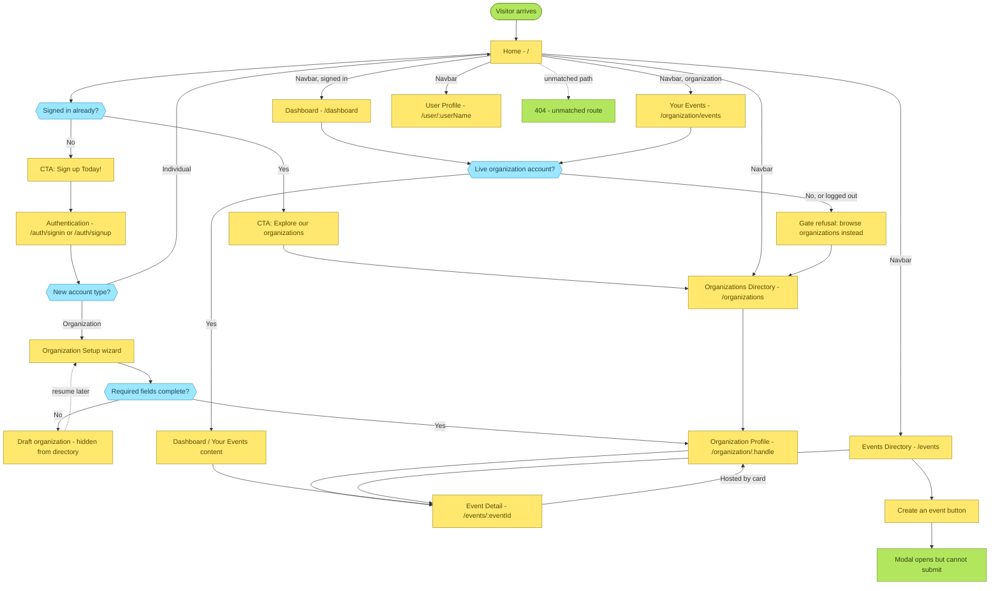
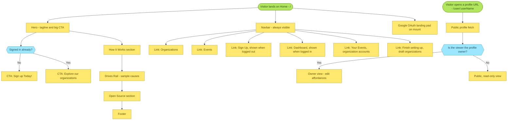

# User Flows

This file is the visual complement to the feature specs, not a replacement for them.
It shows how a visitor actually moves between pages and states: what each page branches on, what a button does, and where a known bug breaks the flow.
For the business logic behind any node here, follow the link in its label to the owning spec - [authentication.md](./authentication.md), [organizations.md](./organizations.md), [events.md](./events.md), [landing-home.md](./landing-home.md), [onboarding-profile.md](./onboarding-profile.md), [dashboard.md](./dashboard.md).
These diagrams describe the code as it exists today, rough edges included, the same as every other file in this directory - see [known-issues.md](./known-issues.md) for the write-ups behind the broken-looking nodes below.
Update the relevant diagram in the same change whenever a route, redirect, or gated page changes - see the root [CLAUDE.md](../../CLAUDE.md) "Docs and memory move with the code" rule.

Every diagram uses the same three node colors:

- **Yellow** - a page, section, or action.
- **Blue** - a decision point (the branch condition is on the arrows out of it).
- **Green** - a true start/end point, a redirect target, or a documented known issue.
- **Dashed arrows** mark a hypothetical or not-currently-reachable path, called out explicitly in the node text.

## Site map

The top-level view: every route, the main redirects, and which pages gate on account type or organization status.
Start here before opening one of the detailed diagrams below.

## Home and your profile

See [landing-home.md](./landing-home.md) and [onboarding-profile.md](./onboarding-profile.md).

## Sign in and sign up

See [authentication.md](./authentication.md).
One component, `Auth.tsx`, renders both `/auth/signin` and `/auth/signup`; the URL does not decide which form shows, the email-lookup result does.

## Organizations - directory, profile, and admin surfaces

See [organizations.md](./organizations.md) and [dashboard.md](./dashboard.md).
`OrganizationSetupGate` is the one mechanism behind both `/dashboard` and `/organization/events` - it is not a route guard, it wraps page content.

## Events - directory, detail, and creating one

See [events.md](./events.md) and [known-issues.md](./known-issues.md).
The create-event path is deliberately drawn with its real, broken state: `CreateEvent.tsx` (the modal actually wired to the "Create an event" button) can never be submitted, and even if it could, it calls the wrong endpoint.
`CreateEvents.tsx` is the correct implementation and is not rendered from any page today.

```mermaid
flowchart TD
    classDef general fill:#FFE86D,stroke:#A28E26,color:#574900
    classDef decision fill:#9CE6FF,stroke:#2C97BB,color:#1C4657
    classDef terminator fill:#B3E65F,stroke:#6E9A24,color:#2F440B

    e_start(["Visitor opens Events"]):::terminator
    e_fetch["GET /events, limit 100 - fetched once"]:::general
    e_search["Search - client-side"]:::general
    e_time["Upcoming / Past filter - client-side"]:::general
    e_type["Type filter: invite-only, open, online, offline - client-side"]:::general
    e_grid["Grid of Event Cards"]:::general
    e_create_btn["Create an event button"]:::general
    e_modal["CreateEvent.tsx modal opens"]:::general
    e_wired{{"Are the address fields wired to inputs?"}}:::decision
    e_disabled["Save button stays disabled - cannot submit"]:::terminator
    e_wrong["If it could submit: patches the USER profile, not an event"]:::general
    e_real["CreateEvents.tsx - the correct version, never rendered anywhere"]:::terminator
    e_backend{{"Backend: is the host an organization account?"}}:::decision
    e_rejected["403 NOT_AN_ORGANIZATION"]:::terminator
    e_saved["Event saved with organizerHandle from host"]:::terminator
    e_detail_fetch{{"Event found?"}}:::decision
    e_404["Not-found state"]:::terminator
    e_hero["Event Hero"]:::general
    e_about["About this event"]:::general
    e_facts["The details - Event Facts"]:::general
    e_agenda["How the day runs - Agenda, if any"]:::general
    e_location["Where it is / How to join"]:::general
    e_bring["What to bring"]:::general
    e_join["Join Panel - cost, capacity, Join button, local only"]:::general
    e_timing{{"Event timing?"}}:::decision
    e_completed["Completed wrap-up shown instead of Join"]:::general
    e_invite{{"Invite only?"}}:::decision
    e_nojoin["No join control shown"]:::general
    e_joinactive["Join button active"]:::general
    e_organizer["Organizer Panel - Hosted by, links to organization profile"]:::general
    e_fundraiser["Fundraiser Panel - shown only if the event has one"]:::general
    e_mobilebar["Mobile Action Bar - fixed bottom, hides near Join Panel or footer"]:::general

    e_start --> e_fetch
    e_fetch --> e_search
    e_search --> e_time
    e_time --> e_type
    e_type --> e_grid
    e_grid --> e_create_btn
    e_create_btn --> e_modal
    e_modal --> e_wired
    e_wired -->|"No - never wired"| e_disabled
    e_disabled -.->|"hypothetically, if it could submit"| e_wrong
    e_modal -.->|"correct component exists separately"| e_real
    e_real -.-> e_backend
    e_backend -->|"No"| e_rejected
    e_backend -->|"Yes"| e_saved
    e_grid --> e_detail_fetch
    e_detail_fetch -->|"No"| e_404
    e_detail_fetch -->|"Yes"| e_hero
    e_hero --> e_about
    e_about --> e_facts
    e_facts --> e_agenda
    e_agenda --> e_location
    e_location --> e_bring
    e_hero --> e_join
    e_join --> e_timing
    e_timing -->|"Past"| e_completed
    e_timing -->|"Upcoming"| e_invite
    e_invite -->|"Yes"| e_nojoin
    e_invite -->|"No"| e_joinactive
    e_join --> e_organizer
    e_join --> e_fundraiser
    e_hero --> e_mobilebar
```

