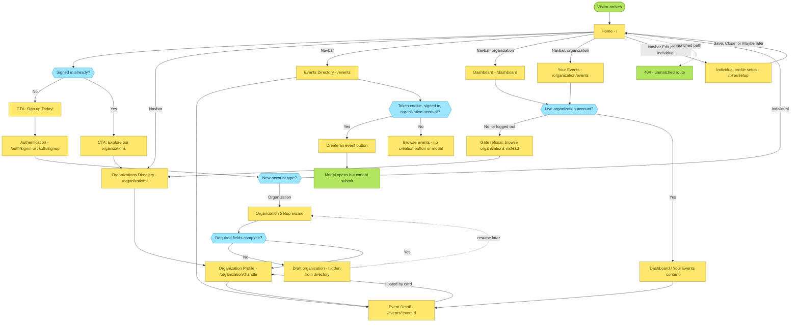
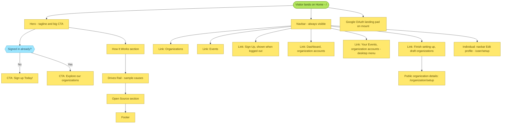
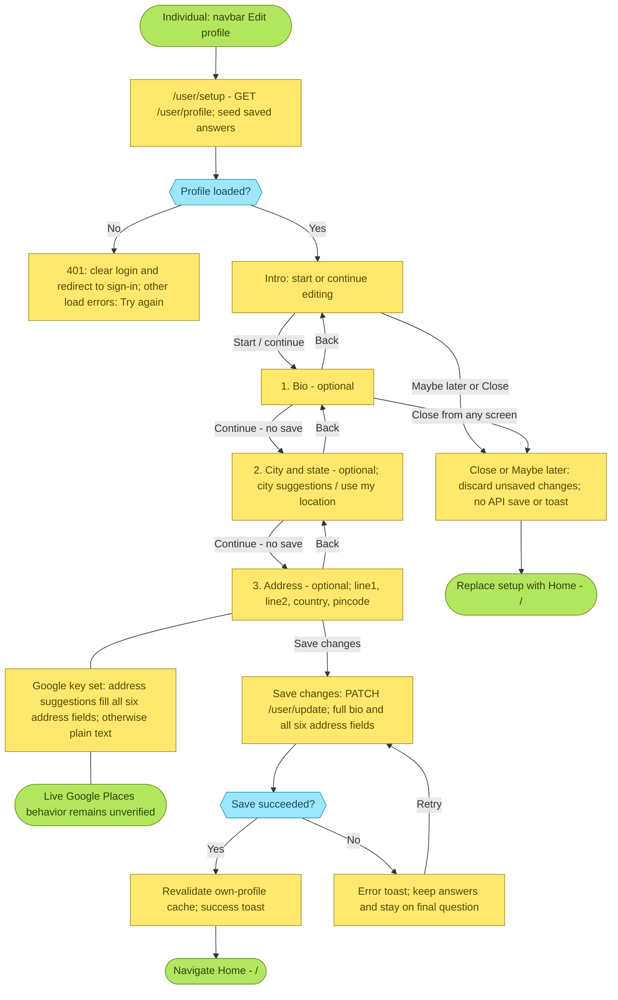
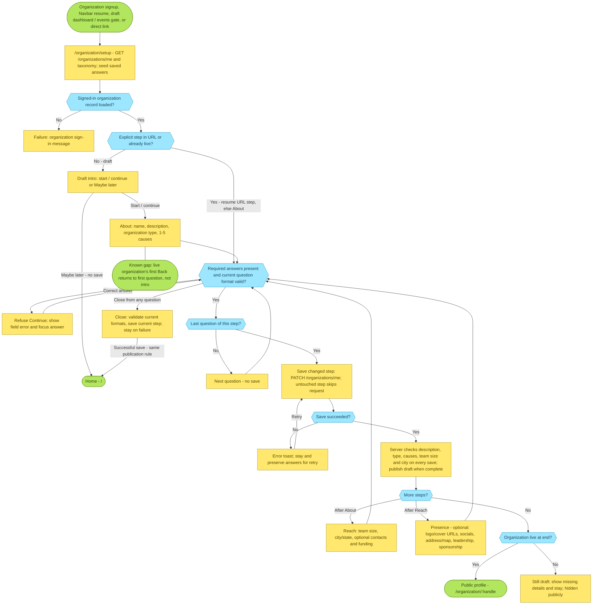
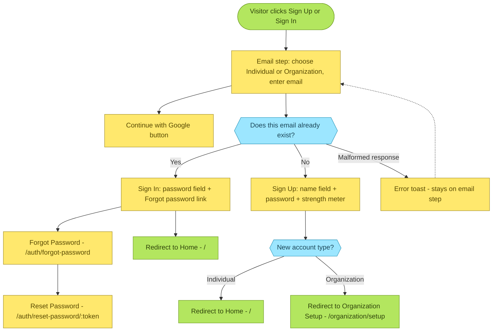
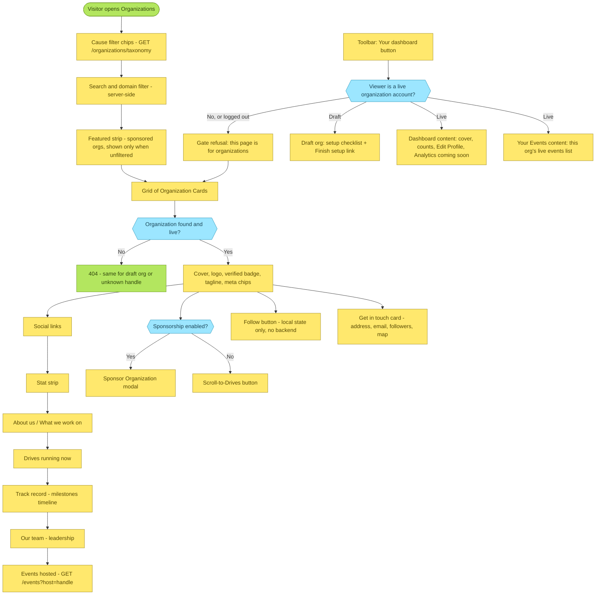
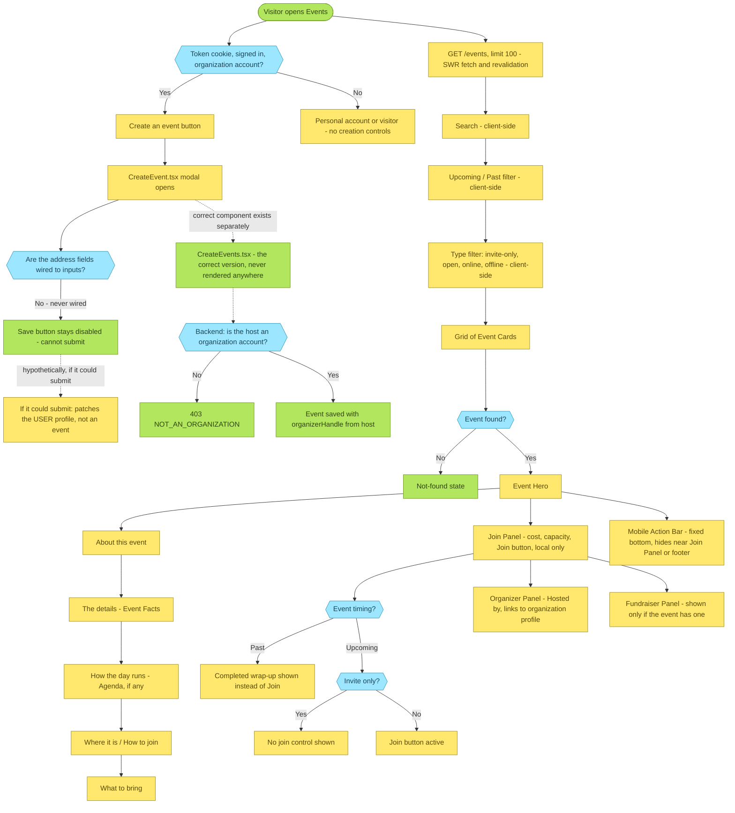

# User Flows

This file is the visual complement to the feature specs, not a replacement for them.
The matching Miro flows live on [Claude Dashboard](https://miro.com/app/board/uXjVHHhntxM=/); keep both representations updated when changing these flows.
It shows how a visitor actually moves between pages and states: what each page branches on, what a button does, and where a known bug breaks the flow.
For the business logic behind any node here, follow the link in its label to the owning spec - [authentication.md](./authentication.md), [organizations.md](./organizations.md), [events.md](./events.md), [landing-home.md](./landing-home.md), [onboarding-profile.md](./onboarding-profile.md), [dashboard.md](./dashboard.md).
These diagrams describe the code as it exists today, rough edges included, the same as every other file in this directory - see [known-issues.md](./known-issues.md) for the write-ups behind the broken-looking nodes below.
Update the relevant diagram in the same change whenever a route, redirect, or gated page changes - see the root [CLAUDE.md](../../CLAUDE.md) "Docs and memory move with the code" rule.

Every diagram uses the same three node colors:

- **Yellow** - a page, section, or action.
- **Blue** - a decision point (the branch condition is on the arrows out of it).
- **Green** - a true start/end point, a redirect target, or a documented known issue.
- **Dashed arrows** mark a hypothetical or not-currently-reachable path, called out explicitly in the node text.

## Site map

The top-level view: every route, the main redirects, and which pages gate on account type or organization status.
Start here before opening one of the detailed diagrams below.

## Home and your profile

See [landing-home.md](./landing-home.md) and [onboarding-profile.md](./onboarding-profile.md).

## Individual profile setup and editing

Checked against `ProfileSetup.tsx`, `useProfileSetup.ts`, `profileSetup.ts`, `profileSetupForm.ts`, and the users API on 26 October 2026.
This describes current code, including the failure paths; it is not a claim that the app was run during this documentation update.
See [onboarding-profile.md](./onboarding-profile.md) and [known-issues.md](./known-issues.md#individual-profile-setup---flow-audit-26-october-2026).
New individual signup still goes to Home; setup starts from desktop/mobile Edit profile or a direct `/user/setup` link.
Signed-out direct visits redirect to `/auth/signin`; remembered login is verified before app startup.
All three questions are optional, and the URL records the question position, not unsaved answers.
Only the final Save changes sends the complete form; moving between questions does not save.
Close and Maybe later discard unsaved changes and return Home.
Successful save returns Home; no completion bypass is needed after removing the sparse profile page.

## Organization profile setup and editing

Checked against `OrganizationSetup.tsx`, `useOrganizationSetup.ts`, `organizationSetup.ts`, `organizationSetupForm.ts`, and `organization.service.ts` on 26 October 2026.
See [organizations.md](./organizations.md#the-setup-flow--organizationsetup) and [the backend organization spec](../../apps/api/docs/specs/organizations.md).
This wizard updates the separate Organization record; the legacy organization-account `ProfileUpdate` modal updates the User record instead.
The wizard has 13 questions across About (4), Reach (4), and Presence (5).
Required answers block Continue, but Close can save an incomplete step and leave.
Every changed step saves only its own fields; an unchanged step skips the request.
Publication happens on whichever save first satisfies the backend's five required fields, normally the Reach save, before the optional Presence questions finish.
A live organization stays live when subsequently edited.

Back moves to the previous question, or the preceding step's last question, without saving.
For a draft, Back from the first question reaches the intro; for a live organization, the documented first-question Back gap applies.
The setup gate resumes at the first step with missing required fields, not necessarily the last question visited.
Refresh keeps URL position and server-saved answers; it loses edits made since the last step save.

## Sign in and sign up

See [authentication.md](./authentication.md).
One component, `Auth.tsx`, renders both `/auth/signin` and `/auth/signup`; the URL does not decide which form shows, the email-lookup result does.

## Organizations - directory, profile, and admin surfaces

See [organizations.md](./organizations.md) and [dashboard.md](./dashboard.md).
`OrganizationSetupGate` is the one mechanism behind both `/dashboard` and `/organization/events` - it is not a route guard, it wraps page content.

## Events - directory, detail, and creating one

See [events.md](./events.md) and [known-issues.md](./known-issues.md).
The create-event path is deliberately drawn with its real, broken state: `CreateEvent.tsx` (the modal actually wired to the "Create an event" button) can never be submitted, and even if it could, it calls the wrong endpoint.
`CreateEvents.tsx` is the correct implementation and is not rendered from any page today.
Creation controls require the `Token` cookie, Redux login state, and an organization account; personal accounts and signed-out visitors only browse.
The API independently rejects personal-account creation requests with `403`.
Upcoming is the default filter and compares each event start time to the current time when the page opens.
Expired demo dates therefore belong under Past, even when the API returns many records.
Refresh demo dates from `apps/api` with `pnpm exec tsx scripts/seed-demo-data.ts --events-only`; this changes only known demo events.
On 26 October 2026, the refreshed local API returned 18 demo events: 15 upcoming and 3 past.
Search matches over returned names, organizers, descriptions, cities, countries, platforms, and modes were checked against the live API data; no browser check was run.
Personalized feed remains deferred; persistent attendance and following are not implemented yet, and existing Join/Follow controls only change local UI state.

